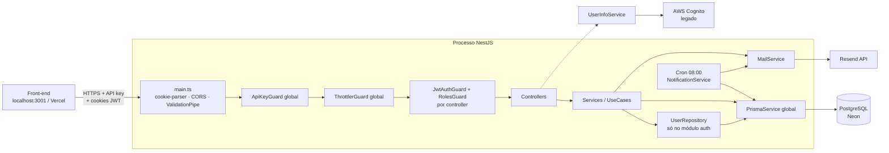

# Arquitetura do back-end

Este documento descreve o estado **atual** do código. Itens marcados como _a confirmar_ não puderam ser verificados só pela leitura do código.

## Visão geral

Aplicação NestJS 11 monolítica (um único processo HTTP, adaptador Express) com PostgreSQL via Prisma 7.
Não há filas, workers separados, cache nem comunicação em tempo real (WebSocket/SSE). A única tarefa em
segundo plano é um cron diário dentro do próprio processo (`@nestjs/schedule`).

## Inicialização (`src/main.ts`)

1. `NestFactory.create(AppModule)`.
2. `cookie-parser` para ler `req.cookies` (os JWT vivem em cookies).
3. CORS com `credentials: true` e origens fixas: `http://localhost:3001` e `https://projeto-pessoal-frontend.vercel.app`.
4. `ValidationPipe` global: `whitelist: true`, `forbidNonWhitelisted: true`, `transform: true`.
   - `transform` converte parâmetros `@Param('x') x: number` / `@Query('x') x: number` para número (`"abc"` vira `NaN`).
   - A validação só ocorre quando o tipo do parâmetro é uma **classe** DTO. `Partial<Dto>`, `type`s e `@Body('campo')` passam sem validação.
5. Escuta em `PORT` (padrão 3000).

## Módulos e responsabilidades

| Módulo | Pasta | Responsabilidade | Depende de |
|---|---|---|---|
| `AppModule` | `src/app.module.ts` | Raiz; registra `ScheduleModule`, `ThrottlerModule` (100 req/60 s) e os guards globais `ApiKeyGuard` e `ThrottlerGuard` | todos |
| `PrismaModule` | `modules/prisma` | `@Global`; `PrismaService` estende `PrismaClient` com adapter `PrismaPg`; no `onModuleInit` roda `SELECT 1` e derruba o boot se falhar | `DATABASE_URL` |
| `AuthModule` | `modules/auth` | Login, cadastro, refresh, logout, perfil (nome, foto, senha), exclusão de conta, recuperação de senha, CRUD básico de usuários; exporta o padrão de guards (`JwtAuthGuard`, `RolesGuard`, `@Roles`) | `JwtModule`, `MailModule`, Prisma |
| `AdminModule` | `modules/admin` | CRUD de roles e atribuição de roles a usuários; tudo restrito a `ADMIN` | Prisma |
| `FinancialModule` | `modules/financial` | Painéis (contas), categorias e movimentações; agregações para gráficos | Prisma |
| `TarefasModule` | `modules/tarefas` | Tarefas, categorias de tarefa, visão semanal, cards e gráfico | Prisma |
| `NotificationModule` | `modules/notification` | CRUD de notificações e envio diário por e-mail (cron) | Prisma, `MailModule` |
| `MailModule` | `modules/mail` | `MailService.sendMail(to, subject, html)` via Resend | `RESEND_*` |
| `UserInfoModule` | `modules/userInfo` | `GET /user-info` consulta AWS Cognito (`us-east-2`) com um token — parece legado de uma auth anterior (_a confirmar_) | AWS SDK |

### Camadas

- **Controller**: define rota, guards, decorators de throttle, lê `req.user`/`req.cookies`, grava/limpa cookies.
  Não contém regra de negócio, exceto a validação do upload de foto no `AuthController`.
- **Service**: regra de negócio e acesso direto ao Prisma (`this.prisma.<model>`). Cada método tem `try/catch` próprio.
- **Repository** (só `auth`): `UserRepository` concentra as queries de `User`.
- **UseCase** (só `auth`): `RecoveryPasswordUseCase` orquestra geração do código + envio de e-mail, reutilizando `AuthService`.
- **DTO**: classes com `class-validator`. Alguns usam `@Type(() => Date/Number)` para conversão.

## Autenticação e autorização

Três camadas, aplicadas nesta ordem:

1. **`ApiKeyGuard` (global, `src/guards/apiKey.guard.ts`)**: toda rota, inclusive `/auth/login`, exige uma chave contida em
   `API_KEY` (aceita várias, separadas por vírgula). A chave é lida de `Authorization: Bearer|ApiKey <key>`, do header `x-api-key`
   ou da query `?api_key=`. Há código comentado para um decorator `@Public()` que não existe hoje.
2. **`ThrottlerGuard` (global)**: 100 requisições por 60 s; algumas rotas de auth sobrescrevem com `@Throttle` (ver `api.md`).
   Não há `trust proxy` configurado; a identificação do cliente atrás de proxy está _a confirmar_.
3. **`JwtAuthGuard` + `RolesGuard` (por controller)**:
   - `JwtStrategy` extrai o JWT **apenas** do cookie `accessToken`, valida com `JWT_SECRET`, busca o usuário por `payload.sub`
     (incluindo roles) e popula `req.user = { id, name, email, profilePicture, roles }`.
   - `RolesGuard` lê os metadados de `@Roles(...)` e libera se o usuário tiver **qualquer** uma das roles (comparação por `role.name`).
     Sem `@Roles`, libera.

Tokens (todos assinados com o mesmo `JWT_SECRET`):

| Token | Payload | Validade | Cookie | Path do cookie |
|---|---|---|---|---|
| Access | `{ sub }` | 1 h (`JwtModule` tem padrão 15 min, mas é sobrescrito) | `accessToken`, maxAge 1 h | `/` |
| Refresh | `{ sub }` | 7 d; hash bcrypt salvo em `users.refreshToken` | `refreshToken`, maxAge 7 d | `/auth/refresh` |
| Reset de senha | `{ sub, purpose: 'reset-password' }` | 10 min | `resetPasswordToken`, maxAge 10 min | `/auth/reset-password` |

Todos os cookies: `httpOnly`, `secure`, `sameSite: 'none'`, `partitioned`.

Proteção por controller:

| Controller | Guards | Roles |
|---|---|---|
| `AuthController` | `JwtAuthGuard` por rota (algumas públicas) | nenhuma |
| `AdminController` | JWT + Roles | `ADMIN` |
| `CategoryController` (`financial-category`) | JWT + Roles | `ADMIN`, `Financeiro` |
| `PanelFinancialController` (`financial-panel`) | só JWT | nenhuma |
| `MovementController` (`financial-movement`) | só JWT | nenhuma |
| `TarefasController` | JWT + Roles | `ADMIN`, `Tarefas` |
| `NotificationController` | JWT + Roles | `ADMIN`, `Notificações` |
| `UserInfoController` | só JWT | nenhuma |

**Posse dos dados:**
- Financeiro: os services verificam se o painel pertence a `req.user.id` (`assertPanelOwnership`, `assertCategoryOwnership`,
  `assertMovementOwnership`) e respondem 403 se não pertencer.
- Tarefas, categorias de tarefa e notificações: o `userId`/`user_id` vem do body, da query ou da URL, e não é comparado com `req.user.id`.
  Operações por `id` (PATCH/DELETE) também não verificam o dono.
- Rotas `GET /auth/list`, `PATCH /auth/:id` e `DELETE /auth/:id` exigem só JWT, sem role.

## Tratamento de erros

- Não existe filtro global de exceções; vale o filtro padrão do Nest (`{ statusCode, message, error? }`).
- Exceção local: `ProfilePictureTooLargeFilter` (no `auth.controller.ts`) transforma o `PayloadTooLargeException` do multer em 413 com mensagem em português.
- Padrões encontrados nos services:
  - `throw new HttpException(error.response ?? 'Mensagem', error.status ?? 500)`: erros do Prisma viram 500 com a mensagem fixa.
  - `throw new HttpException(error ?? 'Mensagem', error.status)` (auth, admin, financial): passa o **objeto de erro** como corpo da resposta.
    Quando o status é `undefined` (erro que não é do Nest), o resultado exato está _a confirmar_.
  - `if (error instanceof HttpException) throw error;` antes de embrulhar (financial, parte do auth): preserva 403/401.
  - `AdminService` traduz códigos do Prisma: `P2002` → 409, `P2025` → 404. Nos outros módulos, "registro não encontrado" no update/delete costuma virar 500.
- Listagens que retornam 404 quando vazias: `GET /tarefas` e `GET /notifications/:userId`.

## Validação

- DTOs de classe: `RegisterDto`, `LoginDto`, `UpdateNameDto`, `ChangePasswordDto`, `DeleteAccountDto`, `CreateRoleDto`, `AssignRoleDto`,
  `PanelDTO`, `CategoryDTO`, `MovementDTO`, `MovementsFilterDTO`, `TarefasDTO`, `CategoriasTarefaDTO`, `NotificationDTO`.
- Não validados: todos os PATCH (`Partial<...>`), `@Body('email')`/`@Body('code')`/`@Body('newPassword')`, `ListTarefasType`.
- Parâmetros de rota: `ParseIntPipe` no admin e `ParseArrayPipe` em `financial-category/list`; nos demais casos, conversão implícita do `transform`.

## Logs

- `console.log(error)` dentro dos `catch` (maioria dos services).
- `Logger` do Nest em `PrismaService` (conexão) e `NotificationService` (execução do cron).
- `console.log` de "Server rodando na porta" no boot. Não há logger estruturado nem correlação de requisições.

## Jobs agendados

- `NotificationService.handleDailyNotifications` com `@Cron('0 8 * * *')`, que roda às 08:00 no fuso do servidor
  (fuso de produção _a confirmar_). Chama `sendDueNotifications()`, que também pode ser disparado por `POST /notifications/send`.

## Fluxos principais

### 1. Requisição autenticada
1. O front envia a API key no header e o cookie `accessToken` (`credentials: 'include'`).
2. `ApiKeyGuard` valida a chave; `ThrottlerGuard` conta a requisição.
3. `JwtAuthGuard` → `JwtStrategy.validate` busca o usuário no banco a cada requisição e preenche `req.user`.
4. `RolesGuard` checa `@Roles`.
5. `ValidationPipe` valida/transforma o DTO, o controller chama o service e o service consulta o Prisma.

### 2. Login (`POST /auth/login`)
1. `UserRepository.findByEmail` (com roles). Se não achar ou a senha não bater (`bcrypt.compare`) → 401 "Email ou senha inválidos".
2. Gera access token (1 h) e refresh token (7 d).
3. Salva `bcrypt.hash(refreshToken)` em `users.refreshToken` (só uma sessão ativa por usuário).
4. Controller grava os cookies `accessToken` e `refreshToken`; retorna `{ user }`.

### 3. Refresh (`POST /auth/refresh`)
1. Lê o cookie `refreshToken` (enviado pelo navegador só nesse path).
2. `jwtService.verify` → busca o usuário por `sub` → `bcrypt.compare` com o hash salvo.
3. Emite novo access token e regrava o cookie `accessToken`. O refresh token não é rotacionado.

### 4. Cadastro (`POST /auth/register`)
1. E-mail já existe → 409.
2. Hash da senha (bcrypt, 10 rounds); cria o usuário conectando (ou criando) as roles `Financeiro`, `Notificações`, `Tarefas`.
3. Gera tokens e salva o hash do refresh. **Não grava cookies**: os tokens voltam no corpo da resposta.
4. Envia e-mail de boas-vindas; uma falha no envio é só logada.

### 5. Recuperação de senha
1. `POST /auth/send-email-password-recovery { email }` → `RecoveryPasswordUseCase`: gera um código de 6 dígitos (`crypto.randomInt`),
   salva o hash bcrypt e a expiração (+15 min) em `users` e envia por e-mail. E-mail inexistente → 500 "Erro ao validar e-mail".
2. `POST /auth/validate-code { email, code }` → confere a expiração e o hash, limpa o código e grava o cookie `resetPasswordToken` (10 min).
3. `POST /auth/reset-password { newPassword }` → valida o token e `purpose`, grava o novo hash e limpa o cookie.
   Não invalida o refresh token existente.

### 6. Movimentação financeira (`POST /financial-movement/create`)
1. `assertPanelOwnership(painel_id, req.user.id)`.
2. Cria a movimentação.
3. Lê `panels.initial_value` e soma (`movement_type === 'IN'`) ou subtrai (qualquer outro valor) o `value`, depois atualiza o painel.
   As operações não estão numa transação.
4. A exclusão faz o inverso. A edição (`PATCH update/:id`) **não** recalcula o saldo.

### 7. Envio de notificações (cron ou `POST /notifications/send`)
1. Busca notificações com `isCurrent = true`, `date` dentro do dia atual em **UTC** e `method` em `EMAIL`/`BOTH`.
2. Carrega os e-mails dos usuários e envia `<h2>title</h2>
description
` (com escape de HTML) via Resend.
3. Se `isCurrent` (sempre verdadeiro, por causa do filtro), adia `date` em +1 mês. O ramo que marcaria `isCurrent = false` nunca é alcançado.
4. `WHATSAPP` existe no enum, mas não há envio por WhatsApp implementado.

### 8. Exclusão de conta (`DELETE /auth/me`)
1. Confere a senha atual.
2. `deleteAccountCascade` numa transação: apaga `tarefas`, `categorias_tarefa`, `panels` (o cascade do banco leva `categories` e `movements`),
   `notifications` e o `user`. Limpa os cookies.

## Decisões de design visíveis no código

- **JWT em cookies httpOnly**, não em header: protege contra roubo de token via XSS (motivo citado no README). O header `Authorization`
  ficou livre para a API key.
- **Refresh token guardado como hash bcrypt**: um vazamento do banco não expõe tokens válidos; também limita a uma sessão por usuário.
- **Cookies com `path` restrito** (`/auth/refresh`, `/auth/reset-password`): o navegador só envia esses tokens para as rotas que os usam.
- **`sameSite: none` + `secure` + `partitioned`**: o front (Vercel) e a API ficam em domínios diferentes; `partitioned` (CHIPS) permite
  cookies de terceiros em navegadores que bloqueiam cookies cross-site.
- **API key global**: impede chamadas de clientes que não sejam o front, mesmo em rotas públicas como login e cadastro.
- **Roles como tabela** (migration `20260810190000_add_roles_table` converteu o enum `Role[]`): permite criar roles por módulo
  dinamicamente pelo admin. As roles servem como permissão de acesso a cada módulo do produto.
- **Rate limit específico** em login, cadastro, troca de senha e recuperação: mitiga força bruta no código de 6 dígitos e na senha.
- **Código de recuperação com hash + expiração**: a migration `encrypt_password_code_recovery` trocou `INTEGER` por `TEXT` para guardar o hash.
- **Foto de perfil como data URI no banco** (`users.profilePicture`), com upload em memória e limite de 5 MB: evita um storage externo.
- **`escapeHtml`** nos templates de e-mail com dados do usuário: evita injeção de HTML nos e-mails.
- **Client Prisma gerado dentro de `src/generated/prisma` e versionado**: o build não depende de `prisma generate` no deploy (motivo inferido).
- **Saldo desnormalizado em `panels.initial_value`**: leitura rápida do saldo sem somar as movimentações.

## Testes

- Unitários (Jest, `src/**/*.spec.ts`): `AuthController`, `AuthService`, `JwtStrategy`, `RolesGuard`, `RecoveryPasswordUseCase`,
  `AdminController`, `AdminService`. Usam mocks (sem banco).
- Os módulos financial, tarefas e notification não têm testes.
- Estado em 2026-10-19: 66 passam e 2 falham (`AuthService › login` e `› refresh`, que esperam um `user` sem `profilePicture`/`roles`).
- e2e (`test/app.e2e-spec.ts`): só testa `GET /`, sem enviar API key; na prática deve retornar 401 (_a confirmar_).
