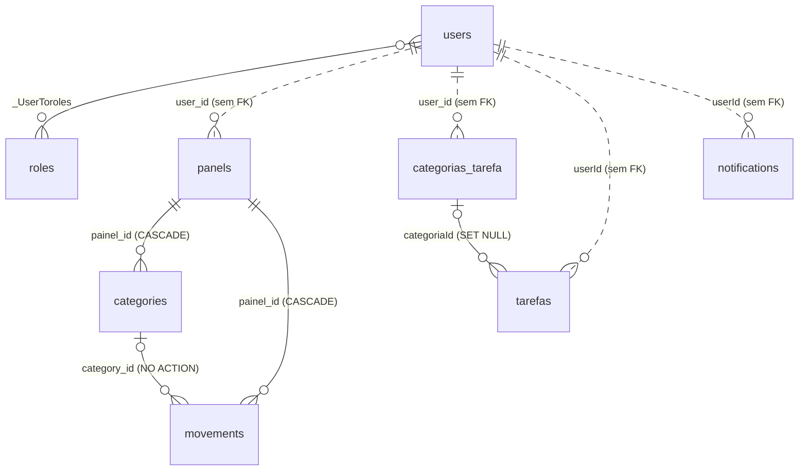

# Modelo de dados

Fonte: `prisma/schema.prisma` e `prisma/migrations/`. Banco: PostgreSQL. O client gerado fica em `src/generated/prisma`
(`provider = "prisma-client"`, `moduleFormat = "cjs"`), usado via `PrismaService` com o adapter `@prisma/adapter-pg`.

## Diagrama

As linhas pontilhadas são vínculos **lógicos**: as colunas guardam o `users.id`, mas não existe foreign key no banco.

## Convenções e observações gerais

- Os nomes de modelos e colunas misturam português/inglês e snake_case/camelCase (`painel_id`, `user_id`, `userId`, `categoriaId`, `created_at`, `createdAt`).
  O Prisma usa o nome do modelo como nome da tabela (só `User` é mapeado para `users`).
- IDs: `users.id` é UUID (`String`); os demais são `SERIAL` (`Int` autoincrement).
- `Decimal` (valores monetários) é serializado em JSON como **string** pelo Prisma (ex.: `"150.00"`); o código converte com `Number(...)` nas agregações.
- `created_at` em snake_case usa `TIMESTAMP(6)` e pode ser nulo; `createdAt`/`updatedAt` em camelCase usam `TIMESTAMP(3)` e são obrigatórios
  (`updatedAt` com `@updatedAt`).
- Índices: só os implícitos (PKs, `users.email` único, `roles.name` único, PK composta e índice em `_UserToroles`). Não há índices nas
  colunas de dono (`user_id`/`userId`) nem nas datas usadas em filtros.

## Entidades

### `User` (tabela `users`)

| Campo | Tipo Prisma / SQL | Nulo | Default | Observação |
|---|---|---|---|---|
| `id` | `String` / TEXT | não | `uuid()` | PK |
| `name` | `String` / TEXT | não | | |
| `email` | `String` / TEXT | não | | **único** (`users_email_key`) |
| `password` | `String` / TEXT | não | | hash bcrypt (10 rounds) |
| `profilePicture` | `String?` / TEXT | sim | | data URI base64 (`data:image/...;base64,...`), até 5 MB de arquivo |
| `createdAt` | `DateTime` / TIMESTAMP(3) | não | `now()` | |
| `updatedAt` | `DateTime` / TIMESTAMP(3) | não | `@updatedAt` | |
| `refreshToken` | `String?` / TEXT | sim | | hash bcrypt do refresh token atual; `null` após logout/troca de senha |
| `passwordCodeRecovery` | `String?` / TEXT | sim | | hash bcrypt do código de 6 dígitos |
| `passwordCodeRecoveryExpiresAt` | `DateTime?` / TIMESTAMP(3) | sim | | agora + 15 min ao gerar o código |
| `roles` | `roles[]` | | | N:N implícita via `_UserToroles` |

Regras:
- Ao se cadastrar, o usuário recebe as roles `Financeiro`, `Notificações` e `Tarefas` (`connectOrCreate` em `UserRepository.registerUser`).
- `ADMIN` só é atribuída por `POST /admin/users/:id/roles` ou direto no banco.
- O campo `password` é retornado por algumas rotas (`PATCH /auth/:id`, `DELETE /auth/:id`), que devolvem o registro completo do Prisma.

### `roles`

| Campo | Tipo | Nulo | Default | Observação |
|---|---|---|---|---|
| `id` | `Int` / SERIAL | não | autoincrement | PK |
| `name` | `String` / TEXT | não | | **único** (`roles_name_key`) |
| `created_at` | `DateTime?` / TIMESTAMP(6) | sim | `now()` | |
| `users` | `User[]` | | | N:N |

Nomes usados no código (`@Roles`): `ADMIN`, `Financeiro`, `Tarefas`, `Notificações`. A comparação é exata (maiúsculas e acentos importam).

### `_UserToroles` (tabela de junção implícita do Prisma)

| Coluna | Tipo | Referência |
|---|---|---|
| `A` | TEXT | `users.id`, ON DELETE CASCADE, ON UPDATE CASCADE |
| `B` | INTEGER | `roles.id`, ON DELETE CASCADE, ON UPDATE CASCADE |

PK `(A, B)`; índice `_UserToroles_B_index` em `B`. Apagar uma role remove o vínculo de todos os usuários.

### `panels` (painel/conta financeira)

| Campo | Tipo | Nulo | Default | Observação |
|---|---|---|---|---|
| `id` | `Int` / SERIAL | não | autoincrement | PK |
| `user_id` | `String?` / TEXT | sim | | dono (`users.id`), **sem FK** |
| `name` | `String` / TEXT | não | | |
| `initial_value` | `Decimal(10,2)` | não | `0` | na prática é o **saldo atual** (ver regras) |
| `created_at` | `DateTime?` / TIMESTAMP(6) | sim | `now()` | |

Relações: `categories[]`, `movements[]` (ambas com ON DELETE CASCADE a partir do painel).

Regras:
- `POST /financial-movement/create` soma (`IN`) ou subtrai (qualquer outro tipo) `value` de `initial_value`; `DELETE` faz o inverso.
  `PATCH` em movimentação não ajusta o saldo. As operações não estão numa transação.
- Na criação, o `user_id` é sempre o do usuário autenticado; no update, `user_id` do body é descartado.

### `categories` (categoria financeira)

| Campo | Tipo | Nulo | Default | Observação |
|---|---|---|---|---|
| `id` | `Int` / SERIAL | não | autoincrement | PK |
| `painel_id` | `Int` | não | | FK → `panels.id`, ON DELETE CASCADE, ON UPDATE NO ACTION |
| `name` | `String` | não | | |
| `color` | `String` | não | | cor (formato livre, ex. hex) |
| `created_at` | `DateTime?` / TIMESTAMP(6) | sim | `now()` | |

Regras com nome "mágico":
- `GET /financial-panel/fees/:id` soma movimentações de categorias cujo nome **contém** `juros` (sem diferenciar maiúsculas).
- `GET /financial-panel/salary/:id` soma entradas (`IN`) de categorias com nome **igual** a `Salário` (sem diferenciar maiúsculas).
- O DTO usa `panel_id`; a coluna é `painel_id` (o service faz o mapeamento só na criação).

### `movements` (movimentação financeira)

| Campo | Tipo | Nulo | Default | Observação |
|---|---|---|---|---|
| `id` | `Int` / SERIAL | não | autoincrement | PK |
| `painel_id` | `Int` | não | | FK → `panels.id`, ON DELETE CASCADE |
| `category_id` | `Int?` | sim | | FK → `categories.id`, ON DELETE **NO ACTION** |
| `name` | `String` | não | | |
| `value` | `Decimal(10,2)` | não | | sempre positivo por convenção; o sinal vem de `movement_type` (_a confirmar_: não há validação de sinal) |
| `movement_type` | `String` | não | | valores usados: `IN` e `OUT` (texto livre, sem enum) |
| `date` | `DateTime` / DATE | não | `CURRENT_DATE` | só a data, sem hora |
| `created_at` | `DateTime?` / TIMESTAMP(6) | sim | `now()` | |

Regras:
- Por causa do `NO ACTION`, excluir uma categoria que tem movimentações falha no banco (o erro sobe como 500).
- O DTO exige `category_id`, embora a coluna aceite nulo.

### `categorias_tarefa`

| Campo | Tipo | Nulo | Default | Observação |
|---|---|---|---|---|
| `id` | `Int` / SERIAL | não | autoincrement | PK (era TEXT antes da migration `20260416122257`) |
| `nome` | `String` | não | | |
| `cor` | `String` | não | | |
| `user_id` | `String?` | sim | | dono, **sem FK** |

Relação: `tarefas[]`.

### `tarefas`

| Campo | Tipo | Nulo | Default | Observação |
|---|---|---|---|---|
| `id` | `Int` / SERIAL | não | autoincrement | PK |
| `userId` | `String` | não | | dono, **sem FK** |
| `nome` | `String` | não | | |
| `status` | `String?` | sim | | valores usados: `Pendente` (default no DTO) e `Concluida` (sem acento) |
| `descricao` | `String?` | sim | | |
| `tempo` | `Int` | não | | minutos (default `0` no DTO); a visão semanal formata como `HHhMMm` |
| `data` | `DateTime` / TIMESTAMP(3) | não | | dia da tarefa; filtros por mês/semana usam limites em UTC |
| `createdAt` | `DateTime` | não | `now()` | |
| `updatedAt` | `DateTime` | não | `@updatedAt` | |
| `categoriaId` | `Int?` | sim | | FK → `categorias_tarefa.id`, ON DELETE **SET NULL**, ON UPDATE CASCADE |

Regras:
- Os agregados (`list-cards`, `grafico-categorias`, `list-categorias`) contam por `status` com comparação exata de string.
- O `TarefasDTO` exige `categoriaId`, embora a coluna aceite nulo.

### `notifications`

| Campo | Tipo | Nulo | Default | Observação |
|---|---|---|---|---|
| `id` | `Int` / SERIAL | não | autoincrement | PK |
| `userId` | `String` | não | | destinatário, **sem FK** |
| `title` | `String` | não | | assunto do e-mail |
| `description` | `String` | não | | corpo do e-mail |
| `date` | `DateTime` / TIMESTAMP(3) | não | | dia do próximo envio (comparado com o dia atual em UTC) |
| `isCurrent` | `Boolean` | não | `true` | só as `true` são enviadas; após o envio, `date` avança +1 mês. Significado de negócio ("ativa" ou "recorrente") _a confirmar_ |
| `method` | enum `NotificationMethod` | não | | `EMAIL`, `WHATSAPP`, `BOTH`; só `EMAIL`/`BOTH` são enviadas (por e-mail) |
| `createdAt` | `DateTime` | não | `now()` | |
| `updatedAt` | `DateTime` | não | `@updatedAt` | |

### Enum `NotificationMethod`
`EMAIL` · `WHATSAPP` · `BOTH`. O DTO tem uma cópia em TypeScript (`notification.dto.ts`); mantenha as duas sincronizadas.

## Exclusão de dados do usuário

Como não há FK de `users` para os dados de domínio, `DELETE /auth/me` usa `UserRepository.deleteAccountCascade`, que numa transação apaga:
`tarefas` (por `userId`) → `categorias_tarefa` (por `user_id`) → `panels` (por `user_id`; o banco leva `categories` e `movements`)
→ `notifications` (por `userId`) → `users`.

`DELETE /auth/:id` apaga só o usuário (e os vínculos em `_UserToroles`) e deixa os dados de domínio órfãos.

## Histórico de migrations

| Migration | Mudança |
|---|---|
| `20260219171611_init` | `categories`, `movements`, `panels`, `users` |
| `20260219172845_add_refresh_token` | `users.refreshToken` |
| `20260415180142_create_tarefas_categorias` | `categorias_tarefa`, `tarefas` (IDs TEXT) |
| `20260416122257_change_categoria_id_to_autoincrement` | IDs de tarefas/categorias viram SERIAL (com perda dos dados da coluna) |
| `20260416162453_add_field_cor_categorias_tarefa` | `categorias_tarefa.cor` |
| `20260416185123_add_field_status_tarefas` | `tarefas.status` |
| `20260622214730_add_notifications` | enum `NotificationMethod`, `notifications` |
| `20260722010907_add_password_code_recovery` | `users.passwordCodeRecovery` INTEGER |
| `20260722234532_encrypt_password_code_recovery` | `passwordCodeRecovery` vira TEXT (hash) |
| `20260810180230_add_user_roles` | enum `Role` + `users.roles Role[]` |
| `20260810190000_add_roles_table` | tabela `roles` + `_UserToroles`, backfill a partir do enum, remove o enum (migration escrita à mão) |
| `20260817181039_add_password_code_recovery_expiry` | `users.passwordCodeRecoveryExpiresAt` |
