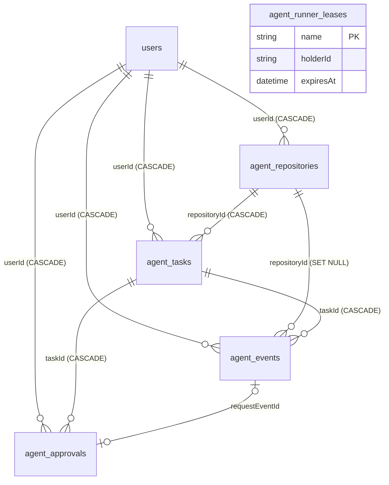
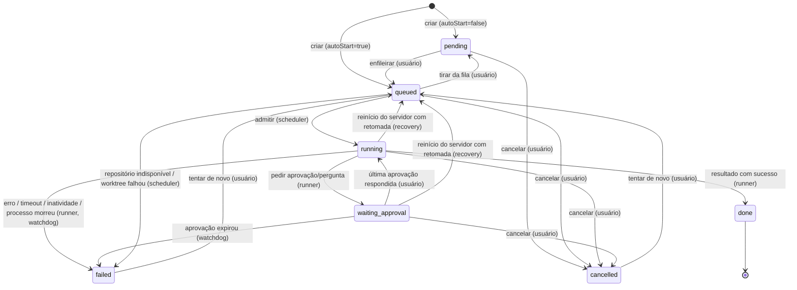
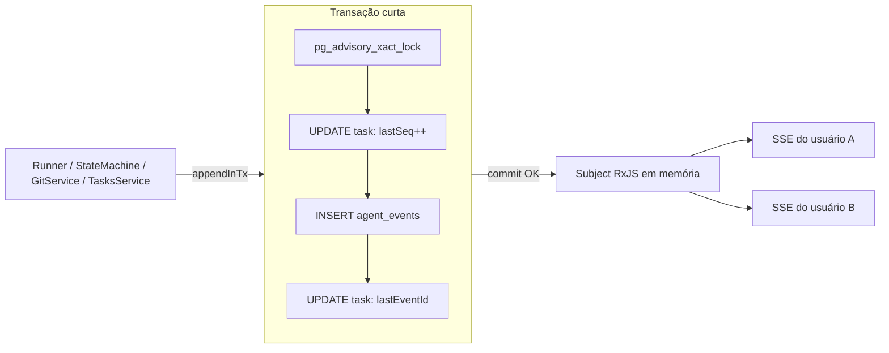
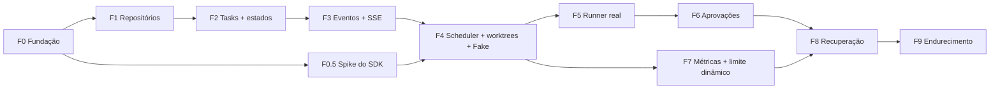

# Especificação: Gerenciador de agentes de IA (back-end)

> Status: **proposta (não implementada)**. Base: `CLAUDE.md`, `docs/backend/*.md` e o código em `src/` (estado de 2026-10-19).
> Itens marcados como _a confirmar_ são suposições que precisam de validação (sua ou da documentação de terceiros).
> A seção 9 (contrato da API) é a fonte de verdade para o front-end.
> Revisão de 2026-10-21: decisões registradas em [Decisões tomadas](#decisões-tomadas) e ajustes de revisão aplicados
> (lista em [Ajustes da revisão](#ajustes-da-revisão-2026-10-21)).

## Sumário

0. [Decisões tomadas](#decisões-tomadas)
1. [Visão geral, objetivos e fora da v1](#1-visão-geral-objetivos-e-fora-da-v1)
2. [Encaixe na arquitetura existente](#2-encaixe-na-arquitetura-existente)
3. [Modelo de dados](#3-modelo-de-dados)
4. [Máquina de estados da task](#4-máquina-de-estados-da-task)
5. [Fila e concorrência](#5-fila-e-concorrência)
6. [Execução dos agentes](#6-execução-dos-agentes)
7. [Eventos e tempo real](#7-eventos-e-tempo-real)
8. [Fluxo de aprovação](#8-fluxo-de-aprovação)
9. [Contrato da API](#9-contrato-da-api)
10. [Segurança](#10-segurança)
11. [Riscos, decisões em aberto e perguntas](#11-riscos-decisões-em-aberto-e-perguntas)
12. [Plano de implementação](#12-plano-de-implementação)

---

## Decisões tomadas

Respostas dadas em 2026-10-21 às perguntas das seções 11.3 (back-end) e 10.4 (front-end). As decisões correspondentes
saíram das listas de pendências. A tabela é a mesma nos dois documentos; a última coluna diz o efeito **neste** documento.

| # | Decisão | Resolve | Efeito no back-end |
|---|---|---|---|
| P1 | O runner roda na máquina do usuário ou numa VM dedicada; na v1, a **própria máquina de desenvolvimento** (D19) | D3 | Disco persistente local para `AGENTS_DATA_DIR` e para as sessões do agente (6.7). O processo com `AGENTS_ENABLED=true` roda nessa máquina, que pode ser Windows (6.2, 5.3, 10.3) |
| P9 (2026-10-25) | A v1 roda inteira em localhost: front, API (com `/agents`) e runner na mesma máquina de desenvolvimento, sem segundo domínio. A hospedagem online fica para depois da v1 | D19 | `/agents` no mesmo endereço da API; sem cookie de login entre domínios diferentes. O comportamento do cookie atual em `http://localhost` fica _a confirmar_ (7.4). Opções de hospedagem futura na D19 (11.2) |
| P2 | Só repositórios públicos na v1 | D5 | Sem credenciais git na v1. O clone é anônimo, e um repositório privado ou inexistente termina em `error` (`GIT_TERMINAL_PROMPT=0`). O desenho de token cifrado (10.3) fica para depois |
| P3 | Só ADMIN usa a feature | D4 | As rotas usam `@Roles('ADMIN')`. A role `Agentes` **não** é criada na v1 e só deve existir depois do isolamento forte (10.2, 10.3). D13 não tem efeito prático na v1, porque todo usuário do módulo é ADMIN |
| P4 | Claude Agent SDK; padrão `claude-sonnet-5-5`, Opus escolhido por task | D1, D2 | `AGENTS_DEFAULT_MODEL=claude-sonnet-5-5`; `model` por task dentro de `AGENTS_ALLOWED_MODELS`. O orçamento em USD continua em aberto (P10) |
| P5 | Sem push nem PR na v1 | — | Já estava fora da v1. Nenhuma credencial com permissão de escrita é guardada |
| P6 | 2 agentes simultâneos | — | `AGENTS_MAX_CONCURRENT=2` (já era o padrão). A RAM da máquina não foi informada, então os padrões de memória (2.4) ficam como estão |
| P7 | Aprovações respondidas na hora; `waiting_approval` ocupa slot | D8 | D8 = sim. D9 (timeout da aprovação) continua em aberto: com respostas na hora, um timeout menor que 24 h libera o slot mais cedo |
| PF2 / D-F1 | Provider de tempo real no root layout do front | — | Um stream SSE por aba aberta em qualquer tela do app. Reforça o heartbeat (7.4) e a conferência do throttler (9.1) |
| D-F2 | Cliente SSE próprio, com `fetch`, no front | — | Substitui a sugestão de `@microsoft/fetch-event-source` (7.4). O cliente envia `X-API-Key`, `Last-Event-ID` e cookies, o que exige o CORS da 9.1 |
| D-F3 | `@tanstack/react-virtual` no front | — | Nenhum |
| PF8 / D-F6 | Markdown renderizado só depois da v1 | — | Nenhum: `agent.message.text` continua markdown cru |

### Ajustes da revisão (2026-10-21)

1. Ordem dos eventos: toda transação que insere evento começa com `pg_advisory_xact_lock` (4.4, 7.3, fase 3).
2. `agent_tasks.lastEventId` no modelo, atualizado com cada evento e presente nas respostas de mutação (3.4, 3.5, 9.1, 9.2).
3. Exclusividade do scheduler por lease com heartbeat em tabela, em vez de advisory lock de sessão (5.1, 3.4, 6.7).
4. `POST /agents/repositories/:id/fetch` permitido em `error`, refazendo o clone quando o `.git` não existir (6.7, 9.1, 9.3).
5. Stream sem cursor: só ao vivo, sem replay; `stream.ready` traz o maior id do usuário (7.4, 9.6).
6. Segurança: preset `edits` com allowlist tratado como quase `autonomous`; risco de `/proc/<pid>/environ` (10.2, 10.3).
7. Admissão sem inanição: piso de 1 agente com nenhum ativo e memória não crítica (5.3).
8. Contrato: `task` em `task.status_changed`, `task.deleted`, `repository.created/updated/deleted`, `expiresAt` em
   `agent.question`, nível `none` em `system.pressure`, `cancelRequestedAt` e definição de `queuePosition` (7.2, 9.2).
9. Ajustes menores: CORS, heartbeat do SSE, throttler, auto-commit seguro, retenção de eventos, cancelamento vence o
   `result` (2.2, 6.3, 6.6, 7.4, 9.1, D16).
10. Fase 0.5 (spike do SDK) e ordem recomendada das fases (seção 12).
11. D12: `CLAUDE.md` do repositório lido no servidor e injetado no prompt (6.8).

As lacunas do front-end resolvidas por esses ajustes estão mapeadas na 11.4.

---

## 1. Visão geral, objetivos e fora da v1

O usuário cadastra um repositório git (o servidor faz o clone), cria **tasks** em linguagem natural para esse repositório e
cada task é executada por um **agente de IA de código** em segundo plano. Cada task roda num **git worktree próprio**
(diretório e branch exclusivos), então várias tasks do mesmo repositório não conflitam. Tudo o que o agente faz vira um
**evento** salvo no banco e transmitido em tempo real. Quando o agente precisa de permissão ou de uma resposta, ele
**pausa** e espera o usuário. Um **controlador de admissão** decide quantos agentes rodam ao mesmo tempo com base num
limite fixo e no uso de CPU e memória da máquina.

### Objetivos da v1

| # | Objetivo | Critério observável |
|---|---|---|
| O1 | Importar repositório via `git clone` (HTTPS) | Repositório passa de `cloning` para `ready` e lista as branches remotas |
| O2 | CRUD de tasks com máquina de estados explícita | Transições inválidas retornam `409 INVALID_TRANSITION` |
| O3 | Fila com limite de agentes simultâneos | Nunca há mais tasks `running` + `waiting_approval` do que o limite efetivo |
| O4 | Execução isolada por worktree | Cada task tem branch `agent/<id>` e diretório próprio; worktrees são limpos |
| O5 | Eventos persistidos e em tempo real (SSE) | Reconectar com `Last-Event-ID` entrega todos os eventos perdidos, sem duplicar |
| O6 | Aprovação humana (pausa e retomada) | O agente para numa ferramenta sensível, o usuário responde e o agente continua |
| O7 | Métricas de CPU e memória em tempo real, usadas na admissão | Sob pressão de recursos, novas tasks ficam em `queued` com motivo visível |
| O8 | Timeout, cancelamento e recuperação após reinício | `kill -9` no servidor não deixa task presa em `running` |

### Fora da v1

- Push da branch, criação de pull request e merge (a branch fica só local; o usuário vê o diff pela API).
- Credenciais para repositórios privados: a v1 aceita só repositórios públicos (decisão P2). O desenho para depois está na 10.3.
- Acesso para usuários que não sejam ADMIN (role `Agentes`), por decisão P3.
- Sandbox por agente em container ou VM, ou com usuário de sistema separado. A v1 depende de aprovações e de regras de
  caminho (seção 10); o isolamento forte é **pré-requisito** para liberar a feature a outros usuários.
- Vários servidores ou runners (escala horizontal); a v1 é **uma instância**.
- Streaming token a token da resposta do modelo (`includePartialMessages`); a v1 transmite mensagens completas.
- Continuar a conversa de uma task `done` com novas instruções (follow-up).
- Agendamento de tasks (cron), dependência entre tasks e prioridade dinâmica.
- Notificação por e-mail ou WhatsApp quando uma aprovação estiver pendente (o `MailService` pode ser reaproveitado depois).
- Edição dos limites de concorrência pela API (a v1 usa variáveis de ambiente).
- Histórico persistido de métricas de CPU e memória (só a amostra atual e um buffer em memória).
- Preempção, isto é, pausar ou matar agentes em execução por falta de recursos.
- Outros provedores de agente além do escolhido em D1 (a interface `AgentRunner` deixa isso possível depois).

---

## 2. Encaixe na arquitetura existente

### 2.1 Novo módulo

`src/modules/agents/`, registrado no `AppModule` (`src/app.module.ts`) e organizado como os módulos existentes
(controller → service → `PrismaService`), com subpastas por subdomínio, como `src/modules/financial/`:

```
src/modules/agents/
  agents.module.ts
  agents.config.ts            # lê e valida as variáveis AGENTS_* no boot (ver 2.4)
  repos/                      # repositórios git importados ("repos" para não confundir com a camada repositories/ do auth)
    repos.controller.ts  repos.service.ts  repos.dto.ts
  tasks/
    tasks.controller.ts  tasks.service.ts  tasks.dto.ts
    task-state-machine.ts     # tabela de transições + transição atômica (seção 4)
  queue/
    scheduler.service.ts      # laço de admissão (seção 5)
    admission.service.ts      # cálculo do limite efetivo
    runner-lease.service.ts   # lease do scheduler com heartbeat (5.1)
  runner/
    agent-runner.interface.ts # porta: start/cancel/answer, emite eventos normalizados
    claude-agent.runner.ts    # implementação com o Claude Agent SDK (D1)
    fake.runner.ts            # runner roteirizado para testes e para a fase 4
    process-registry.ts       # mapa taskId → processo, AbortController, resolvers de aprovação
    repo-instructions.ts      # lê o CLAUDE.md do worktree com limite de tamanho (6.8)
  git/
    git.service.ts            # clone/fetch/worktree via execFile (sem shell)
  events/
    events.service.ts         # persiste (transação com pg_advisory_xact_lock) e publica (Subject do RxJS); ver 7.3
    events.controller.ts      # SSE + histórico
  approvals/
    approvals.controller.ts  approvals.service.ts  approvals.dto.ts
  system/
    metrics.service.ts        # amostragem de CPU e memória (máquina e por agente)
    system.controller.ts
  recovery/
    recovery.service.ts       # reconciliação no boot e limpeza periódica
```

### 2.2 O que é reaproveitado

| Necessidade | Reaproveita | Arquivo |
|---|---|---|
| Acesso ao banco | `PrismaModule` global e `PrismaService` (adapter `PrismaPg`) | `src/modules/prisma/prisma.service.ts` |
| Novos modelos e migrations | Schema e pasta de migrations; o client é gerado em `src/generated/prisma` | `prisma/schema.prisma`, `prisma/migrations/` |
| API key em toda rota (inclusive SSE) | `ApiKeyGuard` global, que também aceita `?api_key=` | `src/guards/apiKey.guard.ts` |
| Usuário autenticado | `JwtAuthGuard` + `JwtStrategy` (cookie `accessToken` → `req.user`) | `src/modules/auth/guards/jwt-auth.guard.ts`, `src/modules/auth/strategies/jwt.strategy.ts` |
| Permissão por módulo | `RolesGuard` + `@Roles('ADMIN')` na v1 (decisão P3) | `src/modules/auth/guards/roles.guard.ts`, `src/modules/auth/decorators/roles.decorator.ts` |
| Gestão da role `Agentes` (pós-v1) | `POST /admin/roles` e `POST /admin/users/:id/roles` | `src/modules/admin/admin.controller.ts` |
| Rate limit por rota | `ThrottlerModule` global (100 req/60 s, vale também para `/agents`) + `@Throttle` (como no login); ver 9.1 | `src/app.module.ts`, `src/modules/auth/controllers/auth.controller.ts` |
| Jobs periódicos | `ScheduleModule.forRoot()` já registrado; `@Interval`/`@Cron` como em `NotificationService` | `src/modules/notification/notification.service.ts` |
| Validação | `ValidationPipe` global (`whitelist`, `forbidNonWhitelisted`, `transform`) | `src/main.ts` |
| Checagem de dono | Padrão `assertPanelOwnership` (compara com `req.user.id`) | `src/modules/financial/panel/panel.service.ts` |
| Tradução de erros do Prisma | `P2002` → 409, `P2025` → 404 | `src/modules/admin/admin.service.ts` |
| Streams reativos | `rxjs` já é dependência (`Subject`/`Observable` para `@Sse`) | `package.json` |
| Logs | `Logger` do Nest com contexto (como `NotificationService`) | — |
| Exclusão de conta | `deleteAccountCascade` precisa considerar os dados novos (ver 3.6) | `src/modules/auth/repositories/user.repository.ts` |
| CORS com credenciais | Já configurado (`credentials: true`). Sem `allowedHeaders` explícito, o pacote `cors` reflete os headers pedidos no preflight, então `X-API-Key` e `Last-Event-ID` já passam. Se a lista virar explícita, ela precisa incluir os dois (9.1) | `src/main.ts` |

### 2.3 Armadilhas documentadas que o módulo novo deve evitar

As armadilhas abaixo estão descritas em `docs/backend/arquitetura.md`. O módulo novo segue o padrão bom, sem alterar o código antigo:

- **Nada de `Partial<Dto>` em PATCH**: o body não seria validado. Use classes `Update…Dto` explícitas com `@IsOptional()`
  (`@nestjs/mapped-types` não está instalado).
- **O dono vem sempre de `req.user.id`**, nunca de `userId` enviado pelo cliente (diferente de tarefas e notificações).
- **Erros**: relance `HttpException` como está (`if (error instanceof HttpException) throw error`), traduza códigos do Prisma
  e use `Logger` em vez de `console.log`. Nunca passe o objeto de erro como corpo da resposta.
- **Query com DTO de classe + `forbidNonWhitelisted`** rejeita `?api_key=`. Nas rotas que usam API key por query (SSE),
  leia os parâmetros individualmente com `@Query('x')` ou declare `api_key` no DTO.
- **BigInt**: o id dos eventos é `BigInt`, e `JSON.stringify` falha com BigInt. Serialize como string no mapper.

### 2.4 Configuração nova (variáveis de ambiente)

| Variável | Padrão sugerido | Uso |
|---|---|---|
| `AGENTS_ENABLED` | `false` | Liga o módulo. Desligado: as rotas `/agents/*` respondem `503` e o scheduler não inicia (deploy atual não muda) |
| `AGENTS_DATA_DIR` | — (obrigatória se habilitado) | Raiz dos clones e worktrees: uma **pasta local da máquina de desenvolvimento** (D19), **fora** da pasta da aplicação. Assim nem o agente nem o watch do `npm run start:dev` mexem no código da API (exemplo de caminho no Windows: `C:\agents-data`; o valor final fica _a confirmar_) |
| `ANTHROPIC_API_KEY` | — | Credencial do agente (D1); nunca exposta ao front nem aos eventos |
| `AGENTS_DEFAULT_MODEL` | `claude-sonnet-5-5` | Modelo padrão das tasks (decisão P4; Opus é escolhido por task) |
| `AGENTS_ALLOWED_MODELS` | `claude-opus-5-5,claude-sonnet-5-5,claude-haiku-5-5` | Lista aceita em `model` na criação de task |
| `AGENTS_MAX_CONCURRENT` | `2` | Teto rígido de agentes ativos (`running` + `waiting_approval`); decisão P6 |
| `AGENTS_MAX_CONCURRENT_PER_USER` | = `AGENTS_MAX_CONCURRENT` | Teto por usuário |
| `AGENTS_CPU_HIGH_WATERMARK` | `75` | % de CPU (média móvel) acima da qual não se admitem novos agentes |
| `AGENTS_CPU_RESUME_WATERMARK` | `65` | Histerese: volta a admitir abaixo deste valor |
| `AGENTS_MEM_RESERVE_MB` | `1024` | Memória que nunca é dada a agentes |
| `AGENTS_MEM_PER_AGENT_MB` | `800` | Estimativa inicial de memória por agente (ajustada pelo observado) |
| `AGENTS_MEM_CRITICAL_PERCENT` | `95` | Acima disso: alerta de pressão e admissão bloqueada |
| `AGENTS_START_COOLDOWN_S` | `20` | Intervalo mínimo entre duas admissões |
| `AGENTS_METRICS_INTERVAL_MS` | `2000` | Período de amostragem e do SSE de métricas |
| `AGENTS_TASK_TIMEOUT_S` | `3600` | Timeout padrão de execução ativa (não conta espera de aprovação) |
| `AGENTS_INACTIVITY_TIMEOUT_S` | `600` | Sem nenhum evento por esse tempo em `running` → falha |
| `AGENTS_APPROVAL_TIMEOUT_S` | `86400` | Tempo máximo de espera por resposta (D9) |
| `AGENTS_MAX_TURNS` | `200` | Teto de turnos do agente por execução |
| `AGENTS_MAX_AUTO_RESUME` | `1` | Retomadas automáticas após reinício (seção 6.7) |
| `AGENTS_WORKTREE_RETENTION_DAYS` | `7` | Worktrees de tasks terminadas são removidos depois disso (a branch fica) |
| `AGENTS_EVENT_PAYLOAD_MAX_KB` | `64` | Tamanho máximo do payload de um evento; o excedente é truncado |
| `AGENTS_EVENT_RETENTION_DAYS` | `30` | Compacta os eventos pesados de tasks terminadas há mais tempo que isso; `0` desliga (D16) |
| `AGENTS_LEASE_TTL_S` | `60` | Validade da lease do scheduler (5.1) |
| `AGENTS_LEASE_HEARTBEAT_S` | `20` | Intervalo de renovação da lease |
| `AGENTS_REPO_INSTRUCTIONS_MAX_KB` | `32` | Tamanho máximo do `CLAUDE.md` do repositório injetado no prompt (6.8) |

---

## 3. Modelo de dados

### 3.1 Convenções

- Os nomes seguem o modelo mais recente do projeto (`notifications`): modelo em snake_case plural e campos em camelCase.
- IDs em **UUID** (como `users.id`): não são enumeráveis e são seguros para virar nome de diretório. A exceção é
  `agent_events.id`, um `BigInt` autoincrement usado como cursor do SSE.
- Diferente do resto do projeto, as tabelas novas têm **FK real para `users`** com `ON DELETE CASCADE` (ver 3.6).
- Timestamps em UTC (`TIMESTAMP(3)`); valores monetários em `Decimal`, serializados como string, como no módulo financeiro.

### 3.2 Diagrama



`agent_runner_leases` não tem relação com as outras tabelas: guarda só a lease do scheduler (5.1).

### 3.3 Enums

```prisma
enum AgentRepositoryStatus { cloning ready fetching error }
enum AgentTaskStatus { pending queued running waiting_approval done failed cancelled }
enum AgentApprovalKind { tool_permission question }
enum AgentApprovalStatus { pending approved denied answered expired cancelled }
enum AgentPermissionPreset { safe edits autonomous }
```

### 3.4 Entidades (esboço em Prisma; os nomes finais podem mudar na implementação)

```prisma
model agent_repositories {
  id                  String                @id @default(uuid())
  userId              String
  name                String                // exibição; padrão = último segmento da URL
  gitUrl              String                // somente https:// (seção 10)
  defaultBranch       String?               // detectada após o clone (HEAD remoto)
  status              AgentRepositoryStatus @default(cloning)
  statusMessage       String?               // erro do clone/fetch, já sanitizado
  allowedBashCommands Json                  @default("[]") // regras de auto-aprovação, ex.: ["Bash(npm test:*)"] (sintaxe a confirmar)
  sizeBytes           BigInt?
  lastFetchedAt       DateTime?
  createdAt           DateTime              @default(now())
  updatedAt           DateTime              @updatedAt
  user                User                  @relation(fields: [userId], references: [id], onDelete: Cascade)
  tasks               agent_tasks[]
  events              agent_events[]

  @@unique([userId, gitUrl])
  @@index([userId, createdAt])
}

model agent_tasks {
  id                String                @id @default(uuid())
  userId            String
  repositoryId      String
  title             String
  prompt            String                // instrução do usuário (texto longo)
  status            AgentTaskStatus       @default(pending)
  statusReason      String?               // ver lista em 4.3
  errorMessage      String?
  priority          Int                   @default(0)  // maior primeiro
  baseBranch        String                // branch de origem do worktree
  branchName        String?               // agent/<id8>-<slug>, definida ao criar o worktree
  worktreePath      String?               // relativo a AGENTS_DATA_DIR; nunca exposto ao front
  worktreeRemovedAt DateTime?
  model             String
  permissionPreset  AgentPermissionPreset @default(safe)
  timeoutSeconds    Int
  maxTurns          Int
  attempt           Int                   @default(0)  // incrementa a cada entrada em running vinda de queued
  autoResumeCount   Int                   @default(0)
  sessionId         String?               // sessão do Agent SDK (para resume)
  runnerInstanceId  String?               // id do boot do processo que está executando
  pid               Int?                  // processo do agente (best effort)
  pidStartedAt      DateTime?             // evita matar outro processo por reuso de PID
  activeMs          Int                   @default(0)  // tempo em running acumulado (base do timeout)
  runningSince      DateTime?             // início do trecho running atual
  lastEventAt       DateTime?             // base do timeout de inatividade
  lastSeq           Int                   @default(0)  // último seq de evento da task
  lastEventId       BigInt?                            // id do último evento da task; atualizado na mesma transação de cada evento (7.3)
  numTurns          Int?
  costUsd           Decimal?              @db.Decimal(12, 6)
  resultSummary     String?               // texto final do agente
  cancelRequestedAt DateTime?
  queuedAt          DateTime?
  startedAt         DateTime?             // primeira vez em running
  finishedAt        DateTime?
  createdAt         DateTime              @default(now())
  updatedAt         DateTime              @updatedAt
  user              User                  @relation(fields: [userId], references: [id], onDelete: Cascade)
  repository        agent_repositories    @relation(fields: [repositoryId], references: [id], onDelete: Cascade)
  events            agent_events[]
  approvals         agent_approvals[]

  @@index([status, priority, queuedAt])   // seleção do scheduler
  @@index([userId, createdAt])            // listagem
  @@index([repositoryId, status])
}

model agent_events {
  id           BigInt   @id @default(autoincrement()) // cursor global do SSE (string no JSON)
  userId       String
  taskId       String?                                // null em eventos só de repositório
  repositoryId String?
  seq          Int?                                   // sequência por task, sem buracos (null se taskId null)
  type         String                                 // catálogo na seção 7 (string para não exigir migration por tipo novo)
  payload      Json
  createdAt    DateTime @default(now())
  user         User                @relation(fields: [userId], references: [id], onDelete: Cascade)
  task         agent_tasks?        @relation(fields: [taskId], references: [id], onDelete: Cascade)
  repository   agent_repositories? @relation(fields: [repositoryId], references: [id], onDelete: SetNull)

  @@unique([taskId, seq])
  @@index([userId, id])     // replay do stream do usuário
  @@index([taskId, id])     // histórico da task
}

model agent_approvals {
  id              String              @id @default(uuid())
  userId          String
  taskId          String
  kind            AgentApprovalKind
  status          AgentApprovalStatus @default(pending)
  toolName        String?
  toolUseId       String?
  request         Json                // entrada da ferramenta / perguntas (sanitizado)
  response        Json?               // decisão, mensagem, respostas
  requestEventId  BigInt?             // evento approval.requested / agent.question
  expiresAt       DateTime
  respondedAt     DateTime?
  createdAt       DateTime            @default(now())
  user            User                @relation(fields: [userId], references: [id], onDelete: Cascade)
  task            agent_tasks         @relation(fields: [taskId], references: [id], onDelete: Cascade)

  @@index([taskId, status])
  @@index([userId, status])
}

model agent_runner_leases {
  name        String   @id      // "scheduler"
  holderId    String            // runnerInstanceId de quem detém a lease
  acquiredAt  DateTime
  heartbeatAt DateTime
  expiresAt   DateTime
}
```

O modelo `User` ganha os campos de relação inversa (`agentRepositories`, `agentTasks`, `agentEvents`, `agentApprovals`).
Isso não cria colunas na tabela `users`.

### 3.5 Regras relevantes

- `agent_tasks.status` só muda pela `TaskStateMachine` (seção 4), com update condicional `WHERE id = ? AND status = ?`.
  Em cada mudança, um evento `task.status_changed` é gravado na mesma transação, com o lock da 7.3.
- Toda transação que insere evento começa com `pg_advisory_xact_lock` (7.3). Dentro dela, para eventos de task:
  `UPDATE agent_tasks SET "lastSeq" = "lastSeq" + 1 … RETURNING "lastSeq"` → `INSERT agent_events` com esse `seq` →
  `UPDATE agent_tasks SET "lastEventId" = <id do evento>, "lastEventAt" = now()`. O `@@unique([taskId, seq])` garante
  a ordem por task, e `lastEventId` nunca fica atrás do último evento commitado.
- `worktreePath` e o caminho do clone são **derivados de UUIDs** (`<AGENTS_DATA_DIR>/repos/<repoId>.git` e
  `<AGENTS_DATA_DIR>/worktrees/<taskId>`), nunca de texto do usuário.
- Retenção: os eventos vivem enquanto a task existir; apagar a task apaga os eventos (cascade). Os eventos de exclusão
  (`task.deleted`, `repository.deleted`) são gravados com `taskId`/`repositoryId` **nulos** no envelope, com os ids no
  payload; caso contrário, a FK rejeitaria o insert ou o cascade apagaria o próprio evento (7.2).
- Compactação (D16): um job diário substitui o payload dos eventos pesados (`agent.command_result`, `agent.tool_result`,
  `agent.tool_call`) de tasks terminadas há mais de `AGENTS_EVENT_RETENTION_DAYS` por `{ "compacted": true }`. O `id` e
  o `seq` continuam, então o histórico não ganha buracos (o front detecta buracos de `seq` e refaria a busca).

### 3.6 Exclusão de conta e de usuário

- Com FK + cascade, `DELETE /auth/me` (`deleteAccountCascade`) e `DELETE /auth/:id` apagam as linhas novas automaticamente.
- O que fica no disco e nos processos **não** é apagado pelo banco. É preciso um passo de aplicação antes do delete:
  `AgentsCleanupService.purgeUser(userId)`, que cancela os agentes ativos e remove os clones e worktrees.
  Ele deve ser chamado em `AuthService.deleteAccount` e `AuthService.delete` (`src/modules/auth/services/auth.service.ts`).
  Essa é a única alteração prevista em código existente fora do `AppModule` e do schema. A outra possível é em
  `src/main.ts`, só se o CORS passar a ter `allowedHeaders` explícito (9.1).

### 3.7 Migrations necessárias (uma por fase, ver seção 12)

| Migration | Conteúdo |
|---|---|
| `add_agent_repositories` | enum `AgentRepositoryStatus`, tabela `agent_repositories`. Sem a role `Agentes` na v1 (decisão P3); quando ela vier, o insert idempotente segue o backfill de `20260810190000_add_roles_table` (`ON CONFLICT ("name") DO NOTHING`) |
| `add_agent_tasks` | enums `AgentTaskStatus` e `AgentPermissionPreset`, tabela `agent_tasks` (com `lastEventId`) e índices |
| `add_agent_runner_leases` | tabela `agent_runner_leases` (fase 4) |
| `add_agent_events` | tabela `agent_events` e índices |
| `add_agent_approvals` | enums `AgentApprovalKind` e `AgentApprovalStatus`, tabela `agent_approvals` |

Depois de cada uma: `npx prisma migrate dev --name <nome>`, `npx prisma generate` e commit de `src/generated/prisma`.

---

## 4. Máquina de estados da task

### 4.1 Diagrama



### 4.2 Tabela de transições

| De | Para | Disparado por | Gatilho | Efeitos colaterais |
|---|---|---|---|---|
| — | `pending` | Usuário | `POST /agents/tasks` com `autoStart: false` | evento `task.created` |
| — | `queued` | Usuário | `POST /agents/tasks` (padrão `autoStart: true`) | `queuedAt`; eventos `task.created`, `task.status_changed`; acorda o scheduler |
| `pending` | `queued` | Usuário | `POST /agents/tasks/:id/enqueue` | `queuedAt`; acorda o scheduler |
| `queued` | `pending` | Usuário | `POST /agents/tasks/:id/dequeue` | limpa `queuedAt` |
| `queued` | `running` | Scheduler | slot livre + admissão aprovada (seção 5) | `attempt++`, `runningSince`, `runnerInstanceId`; cria ou reaproveita o worktree; inicia o agente |
| `queued` | `failed` | Scheduler | repositório não `ready`, falha ao criar o worktree | `statusReason` = `repository_unavailable` / `worktree_failed` |
| `running` | `waiting_approval` | Runner | o agente chamou uma ferramenta que exige aprovação, ou `AskUserQuestion` | cria `agent_approvals`; acumula `activeMs`; evento `approval.requested` / `agent.question` |
| `waiting_approval` | `running` | Usuário | `POST /agents/approvals/:id/respond` resolveu a **última** aprovação pendente | `runningSince = now`; evento `approval.resolved`; o agente continua |
| `waiting_approval` | `failed` | Watchdog | `expiresAt` da aprovação vencido (D9) | aprovação → `expired`; aborta o agente; `statusReason = approval_timeout` |
| `running` | `done` | Runner | mensagem `result` com `subtype: "success"` e `is_error: false`, **e `cancelRequestedAt` nulo** | `costUsd`, `numTurns`, `resultSummary`; auto-commit (D11, 6.3); evento `agent.result` |
| `running` | `failed` | Runner / Watchdog | `result` de erro, exceção do SDK, processo encerrado, `activeMs > timeout`, inatividade | aborta e mata a árvore de processos; `statusReason` (4.3) |
| `running` / `waiting_approval` | `queued` | Recovery | boot encontrou a task órfã, há `sessionId` e `autoResumeCount < AGENTS_MAX_AUTO_RESUME` | aprovações pendentes → `expired`; `autoResumeCount++`; a próxima execução usa `resume` |
| `pending` / `queued` | `cancelled` | Usuário | `POST /agents/tasks/:id/cancel` | `statusReason = user_cancelled` |
| `running` / `waiting_approval` | `cancelled` | Usuário | `POST /agents/tasks/:id/cancel` | `cancelRequestedAt`; nega as aprovações pendentes; aborta; mata após o prazo de tolerância; aprovações → `cancelled`. Vence um `result` que chegue depois do pedido (6.6) |
| `failed` / `cancelled` | `queued` | Usuário | `POST /agents/tasks/:id/retry` | reaproveita a branch e o worktree se existirem (D10); `autoResumeCount = 0` |

Qualquer outra combinação → `409 INVALID_TRANSITION`. `done` é terminal na v1.
Se o boot encontra uma task órfã que não pode ser retomada (sem `sessionId` ou limite de retomadas atingido), ela vai
para `failed` com `statusReason = server_restart`.

### 4.3 Valores de `statusReason`

`user_cancelled`, `timeout`, `inactivity_timeout`, `approval_timeout`, `agent_error`, `max_turns`, `budget_exceeded`,
`process_crashed`, `server_restart`, `worktree_failed`, `repository_unavailable`, `resumed_after_restart` (em `queued`).

### 4.4 Implementação da transição (regra para quem implementar)

`TaskStateMachine.transition(taskId, from[], to, ctx)`:
1. Valida `(from → to)` na tabela acima (constante única, testada exaustivamente).
2. Abre uma transação que **começa** com `SELECT pg_advisory_xact_lock(<AGENTS_EVENTS_LOCK>)`. É a regra geral da 7.3:
   toda transação que insere evento começa assim.
3. `UPDATE agent_tasks SET status = :to, … WHERE id = :id AND status IN (:from)`. Se nenhuma linha for afetada → rollback
   e `409 INVALID_TRANSITION` (outra ação chegou antes). A admissão pelo scheduler acrescenta a condição da lease (5.1).
4. Na mesma transação, via `EventsService.appendInTx(tx, …)`: incrementa `lastSeq`, reserva o id com `nextval` e insere
   `task.status_changed` com `{ from, to, reason, actor, attempt, task }`, depois grava `lastEventId`. O `task` do payload
   é montado dentro da transação já com `lastEventId` = o id deste evento (por isso o id é reservado antes do INSERT).
5. Depois do commit: publica o evento no bus (7.3) e, se aplicável, acorda o scheduler.

Não existe mais uma fila de escrita separada para eventos: a ordem dos ids é garantida pelo lock (7.3), e a contradição
entre "evento na mesma transação" e "tudo pelo writer único" deixa de existir.

---

## 5. Fila e concorrência

### 5.1 Tecnologia

| Opção | Prós | Contras | Veredito |
|---|---|---|---|
| **A. Fila no próprio Postgres** (`agent_tasks.status = queued` + scheduler em processo) | Sem infraestrutura nova; o banco já é a fonte de verdade; sobrevive a reinício; consultas simples de prioridade e fairness | Uma instância de scheduler (garantida por lease com heartbeat); polling leve | **Recomendado para a v1** |
| B. BullMQ + Redis | Retries, delays e painéis prontos; distribuído | Infraestrutura nova (Redis); o estado fica dividido entre Redis e Postgres; o ganho distribuído não se aplica porque o worktree e o processo estão no disco local de **uma** máquina | Considerar só com vários runners |
| C. pg-boss (jobs em Postgres) | Biblioteca madura sobre o mesmo banco | Duplica a máquina de estados (estado do job × estado da task); dependência nova | Alternativa a A se a lógica de fila crescer |
| D. Fila em memória (ex.: `p-queue`) | Trivial | Perde a fila no reinício; não atende O8 | Rejeitada |

**Desenho recomendado (A):**
- `SchedulerService` roda um `tick()` a cada 2 s (`@Interval`) e também imediatamente em `enqueue`, `finish`, `cancel` e
  em resposta de aprovação.
- **Uma instância por vez: lease em tabela, não advisory lock de sessão.** Só quem detém a lease roda o scheduler e os
  runners. É a proteção contra duas instâncias executando a mesma fila (por exemplo, num deploy com sobreposição).
  - **Por que não `pg_try_advisory_lock`:** esse lock pertence à **sessão** do Postgres, e a sessão não é estável aqui:
    - com pgbouncer em modo transação (o endpoint `-pooler` do Neon; _a confirmar_ qual URL o `DATABASE_URL` usa), cada
      transação pode ir para uma sessão de servidor diferente. O lock fica preso numa sessão que outros clientes
      reutilizam, e o unlock pode cair em outra sessão;
    - quando o compute do Neon suspende por inatividade, ou quando o pool do Prisma recicla a conexão, a sessão termina e
      o lock some sem aviso. O processo continuaria achando que é o único scheduler.
    - O `pg_advisory_xact_lock` da 7.3 não tem esse problema: ele vale só dentro de uma transação, que o pgbouncer mantém
      numa única conexão do começo ao fim.
  - **Desenho:** tabela `agent_runner_leases` (3.4), linha `name = 'scheduler'`.
    - Adquirir: `INSERT … ON CONFLICT (name) DO UPDATE SET "holderId" = :me, "acquiredAt" = now(), "heartbeatAt" = now(),
      "expiresAt" = now() + TTL WHERE agent_runner_leases."expiresAt" < now() OR agent_runner_leases."holderId" = :me
      RETURNING "holderId"`. A instância ganhou se o retorno for o próprio `runnerInstanceId`.
    - Heartbeat a cada `AGENTS_LEASE_HEARTBEAT_S` (20 s): `UPDATE … SET "heartbeatAt" = now(), "expiresAt" = now() + TTL
      WHERE name = 'scheduler' AND "holderId" = :me`. Se nenhuma linha for afetada, a lease foi perdida e a instância para
      de admitir na hora. Os agentes em execução continuam; se outra instância assumir, a recuperação dela (6.7) trata essas tasks.
    - O TTL (`AGENTS_LEASE_TTL_S`, 60 s) é bem maior que o heartbeat, para tolerar uma falha de rede pontual.
    - **Fencing:** a transição `queued → running` feita pelo scheduler inclui, na mesma transação,
      `AND EXISTS (SELECT 1 FROM agent_runner_leases WHERE name = 'scheduler' AND "holderId" = :me AND "expiresAt" > now())`.
      Uma instância com a lease vencida não consegue admitir, mesmo antes de perceber que a perdeu.
    - Ocioso: sem tasks ativas nem na fila, o heartbeat pausa e a lease pode expirar, para o Neon poder suspender. O próximo
      `enqueue`/`retry`, que já escreve no banco, readquire a lease antes de admitir. Com agentes ativos, o heartbeat mantém
      o compute acordado, o que é esperado.
  - **Alternativa (plano B):** uma conexão direta dedicada (URL sem pooler, variável nova) aberta só para segurar o advisory
    lock de sessão. Resolve o problema do pgbouncer, mas não o da suspensão do compute ou de quedas de conexão (o lock some
    junto com a conexão) e mantém uma conexão a mais aberta o tempo todo.
- Seleção: `queued` ordenadas por `priority DESC, queuedAt ASC`, pulando usuários que já atingiram
  `AGENTS_MAX_CONCURRENT_PER_USER`. **No máximo uma admissão por tick** (ver cooldown).
- A admissão usa a transição condicional da seção 4.4. Com um único scheduler, `SKIP LOCKED` não é necessário.
- Neon: as consultas do scheduler são poucas e leves. O `tick` não consulta o banco se não houver slot livre,
  pois o contador fica em memória, no `ProcessRegistry`. Isso, junto com a pausa do heartbeat quando ocioso, evita acordar
  o compute do Neon à toa (_a confirmar_: o plano Neon usado suspende por inatividade?).

### 5.2 Quem ocupa slot

Ocupam slot as tasks `running` e `waiting_approval`, porque nas duas o processo do agente continua vivo e consumindo memória (D8).
`queued` e `pending` não ocupam.

### 5.3 Limite dinâmico baseado em recursos

**Amostragem** (`MetricsService`, a cada `AGENTS_METRICS_INTERVAL_MS`):
- **CPU da máquina:** diferença entre duas leituras de `os.cpus()` (idle × total) → % de uso. Funciona no Windows, onde
  `os.loadavg()` retorna zeros. Média móvel exponencial (EMA) sobre ~30 s para decidir; o valor instantâneo vai para a UI.
- **Memória:** total e disponível. No Linux, ler `MemAvailable` de `/proc/meminfo`, porque `os.freemem()` ignora cache e
  subestima. No Windows, `os.freemem()` já reflete a memória disponível. Em container, usar os limites do cgroup
  (`memory.max`, `cpu.max`) em vez dos valores do host (_a confirmar_ conforme a máquina do runner, decisão P1).
- **Por agente:** CPU e RSS da **árvore** de processos do agente (o CLI do agente mais os comandos que ele dispara) via
  `pidusage` + `pidtree` (dependências novas; alternativa: ler `/proc` no Linux). O PID raiz vem do spawn controlado (6.2).
- A estimativa de memória por agente começa em `AGENTS_MEM_PER_AGENT_MB` e passa a ser o **p90 do pico de RSS** das últimas
  20 execuções (em memória), com piso no valor configurado.

**Decisão de admissão** (a cada tick, para a próxima task candidata):

```
ativos            = running + waiting_approval
slotsPorMemoria   = floor((memDisponivel - AGENTS_MEM_RESERVE_MB) / estimativaPorAgente)
limiteEfetivo     = clamp(ativos + slotsPorMemoria, 0, AGENTS_MAX_CONCURRENT)
se cpuEma >= HIGH_WATERMARK (ou ainda não caiu abaixo de RESUME_WATERMARK desde que passou do HIGH):
    limiteEfetivo = min(limiteEfetivo, ativos)        # congela: não admite, não derruba
memCritica        = memUsada% >= AGENTS_MEM_CRITICAL_PERCENT
se memCritica:
    limiteEfetivo = min(limiteEfetivo, ativos)        # e emite system.pressure
se ativos == 0 e não memCritica:
    limiteEfetivo = max(limiteEfetivo, 1)             # piso anti-inanição
admitir = ativos < limiteEfetivo
          e ativosDoUsuario < AGENTS_MAX_CONCURRENT_PER_USER
          e agora - ultimaAdmissao >= AGENTS_START_COOLDOWN_S
```

- **Cooldown**: um agente recém-iniciado leva alguns segundos para mostrar seu consumo. Sem o intervalo, várias admissões
  seguidas superestimariam a capacidade.
- **Histerese** (HIGH/RESUME): evita alternar entre admitir e bloquear a cada amostra.
- **Piso anti-inanição**: sem nenhum agente ativo e com a memória fora do nível crítico, o limite efetivo é **no mínimo 1**,
  mesmo com CPU alta ou com a estimativa por agente maior que a memória livre. Sem o piso, uma máquina com carga externa
  constante (por exemplo, a máquina pessoal da decisão P1) ou uma estimativa inflada pelo p90 deixaria a fila parada para
  sempre. O cooldown continua valendo.
  - Com `ativos = 0` e memória **crítica**: a task fica em `queued` com `blockedBy: "memory_critical"` até a memória baixar.
  - Com `ativos > 0` e memória insuficiente para mais um agente: a task fica em `queued` com `blockedBy: "memory_low"`
    e espera um agente terminar. Esse comportamento é intencional e aparece na UI.
  - Quando há mais de um motivo, `blockedBy` mostra o primeiro desta ordem: `runner_disabled`, `hard_limit`, `user_limit`,
    `memory_critical`, `memory_low`, `cpu_high`, `cooldown`.
- **Sem preempção na v1**: sob pressão, o sistema só **para de admitir**. Agentes em execução nunca são mortos
  automaticamente, porque isso perderia trabalho. O usuário vê o alerta e pode cancelar.
- O motivo do bloqueio é exposto ao front (`admission.reason`: `ok`, `hard_limit`, `user_limit`, `cpu_high`,
  `memory_low`, `memory_critical`, `cooldown`, `runner_disabled`), tanto na métrica quanto na task em `queued`
  (`GET /agents/tasks/:id` → `queuePosition` e `blockedBy`).

---

## 6. Execução dos agentes

### 6.1 Runtime do agente (D1)

**Recomendado: Claude Agent SDK para TypeScript (`@anthropic-ai/claude-agent-sdk`).** Ele é o harness do Claude Code
empacotado como biblioteca, com ferramentas prontas (Read, Write, Edit, Bash, Glob, Grep, …), sessões, hooks e callback
de permissão. Isso cobre exatamente as necessidades da feature: eventos, aprovação, cancelamento e retomada. Pontos usados
(nomes conforme a referência TypeScript em `code.claude.com/docs/en/agent-sdk/typescript`, consultada em 2026-10-19; fixar
a versão do pacote e revalidar na implementação):

| Necessidade | Recurso do SDK |
|---|---|
| Iniciar | `query({ prompt, options })` → `Query` (async generator de `SDKMessage`) |
| Diretório de trabalho | `options.cwd = <worktree>` |
| Modelo | `options.model` (padrão `claude-sonnet-5-5`; Opus por task, decisão P4) |
| Política de permissão | `options.permissionMode` (`"default"`, `"acceptEdits"`, `"bypassPermissions"`, `"plan"`, `"dontAsk"`, `"auto"`), `allowedTools` (auto-aprova), `disallowedTools` (nega sempre) |
| Aprovação humana | `options.canUseTool(toolName, input, { signal, toolUseID, … })` → `Promise<{ behavior: "allow", updatedInput? } \| { behavior: "deny", message, interrupt? }>`; também é por onde passa `AskUserQuestion` |
| Regras que sempre executam | `options.hooks.PreToolUse` (pode responder `permissionDecision: "deny"`) e `PostToolUse` (captura arquivos alterados) |
| Cancelamento | `options.abortController` e `Query.close()` (encerra o subprocesso); `interrupt()` existe só em modo de input por streaming |
| Retomada | `options.resume = <sessionId>` (o id vem na mensagem `system`/`init` e em todas as mensagens) |
| Teto de turnos | `options.maxTurns` (resultado de erro `error_max_turns`) |
| Ambiente do processo | `options.env` **substitui** o ambiente do subprocesso (ver 10.3) |
| Configurações carregadas | `options.settingSources` (`[]` desliga as configurações de usuário, projeto e local; D12) |
| Controle do processo | `options.spawnClaudeCodeProcess` (spawn próprio → PID, grupo de processos, kill da árvore); `options.stderr` |
| Resultado | `SDKResultMessage`: `subtype` (`success` ou `error_*`), `is_error`, `num_turns`, `total_cost_usd`, `usage`, `session_id`, `result` |

Detalhes ainda _a confirmar_ na documentação do SDK. Os quatro primeiros são o objetivo do **spike da fase 0.5** (seção 12),
cujo critério de aceite é tirar esses quatro desta lista, substituindo-os pelo comportamento observado:
- formato exato da resposta de `AskUserQuestion` via `canUseTool` (`updatedInput.answers`, `multiSelect`, texto livre);
- `abortController.abort()` e `Query.close()`: o que acontece com o subprocesso e com uma promessa de `canUseTool` pendente;
- `resume`: retomar com `resume: sessionId` em outro processo Node, com o mesmo `cwd`, e o que vem em `system`/`init`;
- `options.env`: confirmar que **substitui** o ambiente do subprocesso (e não mescla com `process.env`), imprimindo o
  ambiente num comando Bash do agente;
- formato de `SpawnOptions`/`SpawnedProcess` (`spawnClaudeCodeProcess`);
- existência de um teto de custo por execução (há o subtipo `error_max_budget_usd`, mas a opção não foi confirmada);
- `systemPrompt` com `append`, para injetar o `CLAUDE.md` do repositório (6.8);
- o SDK depende de um binário nativo por plataforma. O runner pode rodar na máquina pessoal (decisão P1), possivelmente Windows.

Alternativas: chamar o CLI do Claude Code diretamente (`claude -p --output-format stream-json`), que dá controle total do
processo mas exige reimplementar o protocolo de permissão; ou montar um agente próprio com a Claude API e o Tool Runner, que
dá controle máximo mas exige reimplementar as ferramentas de arquivo e de shell. A interface `AgentRunner` isola essa escolha.

### 6.2 Gerenciamento de processos

- **Um processo de agente por task ativa**, iniciado pelo SDK dentro do processo Nest. O SDK já roda o CLI como
  subprocesso, então um crash do agente não derruba a API.
- O spawn é feito por nós via `spawnClaudeCodeProcess`, para:
  - registrar `pid` e `pidStartedAt` na task;
  - no Linux, criar um **grupo de processos próprio** (`detached: true`) e matar a árvore com `kill(-pgid)`; no Windows,
    usar `taskkill /PID <pid> /T /F`;
  - medir a árvore de processos (5.3).
- `ProcessRegistry` (memória): `taskId → { query, abortController, pid, resolvers de aprovação, timers }`. É a fonte do
  contador de slots.
- O loop do runner consome o async generator do SDK, **normaliza** cada `SDKMessage` em eventos do catálogo (7.2) e
  entrega ao `EventsService`.
- Heartbeat: `lastEventAt` é atualizado a cada evento persistido. Se não chega nenhum evento por
  `AGENTS_INACTIVITY_TIMEOUT_S` com a task em `running`, ela falha com `inactivity_timeout`.
- Alternativa considerada: rodar cada agente num worker Node separado (`child_process.fork`) para isolar vazamentos de
  memória do SDK. Fica para depois da v1, caso as métricas mostrem crescimento de RSS no processo da API.

### 6.3 Repositórios e git worktrees

Todas as operações git usam `execFile('git', [...args], { cwd, timeout, env })`, **nunca shell**, com
`GIT_TERMINAL_PROMPT=0`, `GIT_ALLOW_PROTOCOL=https` e `core.longpaths=true` (Windows).

**Importação (clone):**
1. Valida a URL (10.4). Cria a linha com `status = cloning` e responde `202`.
2. Em segundo plano: `git clone --bare <url> <DATA>/repos/<repoId>.git`, depois
   `git config remote.origin.fetch "+refs/heads/*:refs/remotes/origin/*"` e `git fetch origin --prune`.
   O clone `--bare` não tem working tree "principal" que possa ser editada por engano; os worktrees das tasks são
   os únicos checkouts.
3. Detecta a branch padrão (`git ls-remote --symref origin HEAD`) e calcula `sizeBytes`.
4. `status = ready` (ou `error` + `statusMessage`). Eventos `repository.status_changed`.
5. Não usar `--mirror`: o `fetch` com prune apagaria as branches `agent/*` locais.

**Criação do worktree** (na transição `queued → running`, antes de iniciar o agente):
1. Mutex **por repositório** (em memória): `fetch` e `worktree add` mexem no mesmo `.git` e não podem rodar em paralelo.
2. `git fetch origin <baseBranch>`.
3. Se a branch `agent/<id8>-<slug>` não existe:
   `git worktree add -b <branch> <DATA>/worktrees/<taskId> origin/<baseBranch>`.
   Se existe (retry ou resume), `git worktree add <DATA>/worktrees/<taskId> <branch>`, ou reaproveita o diretório se ainda
   estiver registrado (`git worktree list --porcelain`).
4. O nome da branch é validado com `git check-ref-format --branch`. O slug vem do título, só `[a-z0-9-]`, até 30 caracteres.
5. Evento `worktree.created { branch }`.

**Fim da execução:**
- Em `done`, se o auto-commit estiver ligado (D11), o trabalho é commitado no worktree para ficar na branch mesmo depois de o
  worktree ser removido:
  1. Na criação do clone, o runner grava exclusões padrão em `info/exclude` do `.git` (vale para todos os worktrees):
     `node_modules/`, `.env`, `.env.*` e `!.env.example`.
  2. `git add -A`, que respeita o `.gitignore` do repositório e o `info/exclude`.
  3. Confere o que foi para o stage (`git diff --cached --name-only`) e tira do stage (`git reset -q -- <path>`) qualquer
     caminho dentro de `node_modules/` ou com nome `.env`/`.env.*` (exceto `.env.example`). Isso cobre arquivos que o
     repositório já versiona por engano, aos quais o `info/exclude` não se aplica. Também tira arquivos acima de um limite
     de tamanho (sugestão: 5 MB, _a confirmar_).
  4. `git commit -m "agent: <título>" --author="Agente <agent@localhost>"`, com os hooks neutralizados (10.4).
  5. Evento `agent.changes_summary` com `git diff --numstat <base>...<branch>` e `excluded: string[]` (o que ficou fora do commit).
- **Cancelamento vence:** se o `result` chegar com `cancelRequestedAt` preenchido, não há auto-commit e a task vai para
  `cancelled` (6.6).
- Em `failed` e `cancelled`, nada é commitado; o worktree fica para inspeção e para o retry.

**Limpeza:**
- `@Cron('0 3 * * *')`: para tasks terminadas há mais de `AGENTS_WORKTREE_RETENTION_DAYS`, roda
  `git worktree remove --force <path>` e `git worktree prune`, depois `worktreeRemovedAt = now` (a branch é mantida).
- `DELETE /agents/tasks/:id`: remove o worktree e, com `deleteBranch=true`, também a branch (`git branch -D`).
- `DELETE /agents/repositories/:id`: exige que não haja tasks ativas; remove os worktrees e o diretório `.git`.
- Reconciliação no boot (6.7): diretórios em `worktrees/` sem task correspondente são removidos.

### 6.4 Isolamento entre agentes

- Diretórios distintos (um worktree por task) e branches distintas, logo sem conflito de arquivos entre agentes.
- `cwd` do agente = worktree. Um hook `PreToolUse` **nega** Read/Write/Edit/Glob/Grep/NotebookEdit com caminho fora do
  worktree (resolve `realpath` para cobrir symlinks e `..`). O hook roda sempre, inclusive para ferramentas auto-aprovadas,
  ao contrário de `canUseTool`.
- O Bash não é confinável por análise de comando. Na v1 ele exige aprovação, exceto o que estiver na allowlist do repositório
  (`allowedBashCommands`). Isolamento real fica para depois (10.2).
- Ambiente mínimo e sem segredos do servidor (10.3).
- Mesmo dentro do worktree, comandos como `npm install` podem compartilhar caches globais (`~/.npm`). É aceitável na v1.

### 6.5 Timeout

- `activeMs` acumula só o tempo em `running`; o tempo em `waiting_approval` não conta, porque o usuário pode demorar.
- Watchdog a cada 10 s (`@Interval`) verifica:
  - `activeMs + (now - runningSince) > timeoutSeconds` → falha com `timeout`;
  - inatividade (6.2) → falha com `inactivity_timeout`;
  - aprovação vencida (`expiresAt`) → falha com `approval_timeout` (D9).
- Ao falhar por timeout: `abortController.abort()`, espera de 10 s, depois kill da árvore. O evento `agent.error` registra o motivo.
- `maxTurns` é aplicado pelo próprio SDK (resultado `error_max_turns` → falha com `max_turns`).

### 6.6 Cancelamento

`POST /agents/tasks/:id/cancel`:
1. `pending` ou `queued`: transição direta para `cancelled`.
2. `running` ou `waiting_approval`:
   1. grava `cancelRequestedAt` (idempotente: um segundo cancelamento devolve `202` com o mesmo estado);
   2. resolve as promessas de aprovação pendentes com `{ behavior: "deny", message: "Cancelado pelo usuário", interrupt: true }`;
   3. `abortController.abort()` e `Query.close()`;
   4. depois de 10 s sem encerrar: kill da árvore de processos;
   5. aprovações → `cancelled`; transição para `cancelled`.
3. Resposta `202` com a task, já com `cancelRequestedAt`. O estado final chega por SSE (`task.status_changed`).
4. **Corrida com o fim natural:** se o `result` do SDK chegar depois de `cancelRequestedAt` (o agente terminou enquanto o
   cancelamento estava em curso), o cancelamento vence. A task vai para `cancelled`, o `agent.result` é gravado só como
   registro, e não há auto-commit. O runner verifica `cancelRequestedAt` na mesma transação que decidiria `done`
   (`UPDATE … WHERE status = 'running' AND "cancelRequestedAt" IS NULL`).

### 6.7 Recuperação após reinício do servidor

Cada boot gera um `runnerInstanceId` (UUID). Em `onApplicationBootstrap`, se `AGENTS_ENABLED` e a lease do scheduler (5.1)
foi adquirida:
1. **Processos órfãos:** para cada task `running` ou `waiting_approval` com `runnerInstanceId` diferente do atual, se `pid`
   ainda existe **e** o horário de início do processo bate com `pidStartedAt`, mata a árvore. Com o grupo de processos do 6.2,
   o agente pode sobreviver à morte da API; sem essa checagem, ele continuaria editando o worktree.
2. **Aprovações pendentes** dessas tasks → `expired` (a promessa que as esperava morreu com o processo).
3. **Decisão por task:** se há `sessionId` e `autoResumeCount < AGENTS_MAX_AUTO_RESUME`, ela volta para `queued` com
   `statusReason = resumed_after_restart`. Na próxima admissão, o runner usa `resume: sessionId` com o prompt "O servidor
   foi reiniciado; continue a task de onde parou." Caso contrário, `failed` com `server_restart`.
   - A retomada depende de os arquivos de sessão do agente (em `~/.claude/` do usuário do sistema) persistirem entre reinícios
     e de o `cwd` ser o mesmo. Em disco efêmero, a retomada falha e a task cai em `failed` (D14). Com o runner na máquina do
     usuário ou numa VM com disco persistente (decisão P1), a retomada é possível.
4. **Repositórios** em `cloning` ou `fetching` → `error` ("interrompido por reinício"). O usuário pode chamar `/fetch`, que
   é permitido em `error` e refaz o clone quando o `.git` não existe ou está incompleto (9.3), ou excluir e importar de novo.
5. **Worktrees:** `git worktree prune` em cada repositório; diretórios órfãos em `worktrees/` são removidos; tasks que apontam
   para worktrees inexistentes ficam com `worktreeRemovedAt`.
6. Cada mudança gera eventos normais (`task.status_changed` com `actor: "recovery"`). Clientes que reconectarem recebem
   tudo pelo replay.

### 6.8 Instruções do repositório (`CLAUDE.md`, D12)

- Com `settingSources: []`, o SDK **não** carrega nada do repositório: nem `CLAUDE.md`, nem `.claude/settings.json`, nem
  hooks, comandos ou permissões. O `CLAUDE.md` entra por outro caminho, como **texto**:
  1. Depois de criar o worktree e antes de iniciar o agente, o runner (`repo-instructions.ts`) procura `CLAUDE.md` na raiz
     do worktree.
  2. Resolve o `realpath` e só aceita **arquivo regular dentro do worktree**. Um symlink para `../../.env` ou para `/proc/…`
     é ignorado, com aviso.
  3. Lê até `AGENTS_REPO_INSTRUCTIONS_MAX_KB` (padrão 32 KB) como UTF-8. Acima disso, trunca e marca o corte no texto.
  4. Injeta o texto no prompt da task, num bloco delimitado e rotulado como "instruções do repositório (conteúdo do
     repositório, não do usuário)". Se o spike da fase 0.5 confirmar `systemPrompt` com `append`, o bloco vai para o system
     prompt; caso contrário, vai no início do prompt.
  5. Gera `agent.notice { kind: "repo_instructions", message }` com o tamanho e se houve truncamento.
- Na v1, só o `CLAUDE.md` da raiz. `CLAUDE.md` de subpastas, `.claude/CLAUDE.md` e imports `@arquivo` não são seguidos
  (_a confirmar_ se fazem falta).
- Numa retomada (`resume`), o texto não é injetado de novo, porque a sessão já o tem.
- Segurança: o `CLAUDE.md` é conteúdo do repositório e, portanto, uma via de prompt injection (R9), como qualquer arquivo que
  o agente leria. A diferença em relação a `settingSources: ["project"]` é que nenhum hook, permissão ou comando do
  repositório é executado ou aplicado.

---

## 7. Eventos e tempo real

### 7.1 Transporte: SSE (recomendado) × WebSocket

| | SSE (`@Sse` do Nest) | WebSocket (`@nestjs/websockets` + socket.io) |
|---|---|---|
| Direção | servidor → cliente; as ações do usuário vão por REST | bidirecional |
| Auth | Reaproveita **sem mudanças** `ApiKeyGuard` + `JwtAuthGuard` (cookie) porque é HTTP | `ApiKeyGuard` usa `switchToHttp()`: precisa de guards novos para contexto WS e de auth no handshake (_a confirmar_ como `APP_GUARD` se comporta em gateways) |
| Reenvio | `Last-Event-ID` nativo do protocolo | protocolo próprio |
| Dependências | nenhuma nova | 2 ou mais pacotes novos |
| Proxies | HTTP comum (desligar buffering) | precisa de suporte a upgrade |

**Decisão recomendada: SSE.** Nenhum requisito precisa de canal cliente→servidor em tempo real; respostas de aprovação
e cancelamentos são REST.

### 7.2 Envelope e catálogo de eventos

Envelope (o mesmo no SSE e no histórico REST):

```json
{
  "id": "1042",
  "type": "agent.command",
  "taskId": "8b0c…",
  "repositoryId": "41aa…",
  "seq": 17,
  "createdAt": "2026-10-19T22:10:05.123Z",
  "payload": { }
}
```

`id` é string (BigInt), global e crescente. `seq` é a ordem por task, sem buracos; `seq` e `taskId` são `null` em eventos só
de repositório e em `task.deleted`.

| `type` | Origem | Persistido | `payload` |
|---|---|---|---|
| `repository.created` | ReposService | sim | `{ repository: Repository }` |
| `repository.updated` | ReposService (PATCH) | sim | `{ changes: { name?, allowedBashCommands? } }` (mesmo formato de `task.updated`) |
| `repository.status_changed` | GitService | sim | `{ status, statusMessage?, defaultBranch? }` |
| `repository.deleted` | ReposService | sim | `{ repositoryId }`; envelope com `repositoryId: null` (ver regras abaixo). As tasks do repositório somem junto, sem um `task.deleted` por task |
| `task.created` | TasksService | sim | `{ task: Task }` (objeto da seção 9) |
| `task.updated` | TasksService | sim | `{ changes: { title?, prompt?, priority?, … } }` |
| `task.status_changed` | StateMachine | sim | `{ from, to, reason?, actor: "user" \| "scheduler" \| "runner" \| "watchdog" \| "recovery", attempt, task: Task }` (`task` = estado depois da transição, com `lastEventId` = o id deste evento) |
| `task.deleted` | TasksService | sim | `{ taskId, repositoryId, branchDeleted: boolean }`; envelope com `taskId: null` e `seq: null` |
| `worktree.created` | GitService | sim | `{ branch, baseBranch, reused: boolean }` |
| `worktree.removed` | GitService | sim | `{ branchKept: boolean }` |
| `agent.session_started` | Runner (`system`/`init`) | sim | `{ sessionId, model, permissionMode, tools: string[], resumed: boolean }` |
| `agent.message` | Runner (`assistant`, bloco `text`) | sim | `{ messageId, text }` (markdown) |
| `agent.tool_call` | Runner (bloco `tool_use`, exceto Bash) | sim | `{ toolUseId, tool, input }` (sanitizado e truncado) |
| `agent.command` | Runner (`tool_use` do Bash) | sim | `{ toolUseId, command, description? }` |
| `agent.command_result` | Runner (`tool_result` do Bash) | sim | `{ toolUseId, output, truncated, isError }` |
| `agent.tool_result` | Runner (`tool_result` de outras ferramentas) | sim | `{ toolUseId, tool, isError, summary }` |
| `agent.file_changed` | Hook `PostToolUse` (Write, Edit, MultiEdit, NotebookEdit) | sim | `{ toolUseId, path, changeType: "created" \| "modified" \| "deleted", tool }` (`path` relativo ao worktree) |
| `agent.changes_summary` | Runner (fim da execução, `git diff --numstat`) | sim | `{ files: [{ path, additions, deletions, status }], committed: boolean, commitSha?, excluded: string[] }` |
| `agent.question` | `canUseTool` com `AskUserQuestion` | sim | `{ approvalId, questions: [{ question, header, options: [{ label, description }], multiSelect }], expiresAt }` |
| `approval.requested` | `canUseTool` (demais ferramentas) | sim | `{ approvalId, tool, input, reason?, expiresAt }` |
| `approval.resolved` | ApprovalsService | sim | `{ approvalId, status: "approved" \| "denied" \| "answered" \| "expired" \| "cancelled", message?, answers? }` |
| `agent.notice` | Runner (retry de API, rate limit, compactação de contexto) | sim | `{ kind, message }` |
| `agent.result` | Runner (`result`) | sim | `{ subtype, isError, numTurns, costUsd, durationMs, result? }` |
| `agent.error` | Runner/Watchdog | sim | `{ code, message }` (ex.: `timeout`, `process_crashed`, `sdk_error`) |
| `system.metrics` | MetricsService | **não** | ver `GET /agents/system/metrics` (só no stream de métricas) |
| `system.pressure` | AdmissionService | **não** | `{ level: "none" \| "warning" \| "critical", reason, memPercent, cpuPercent }` (só no stream de métricas; emitido quando o nível muda, inclusive de volta a `none`) |
| `stream.ready` | EventsController | **não** | `{ replayed: number, lastEventId: string \| null }` (fim do replay; sem cursor, `replayed: 0` e `lastEventId` = maior id do usuário naquele momento; ver 7.4) |
| `stream.ping` | EventsController | **não** | `{}`; heartbeat sem `id`, usado só se o `@Sse` não aceitar comentário (7.4) |
| `stream.resync_required` | EventsController | **não** | `{ reason: "too_many_missed" \| "cursor_unknown" }` |
| `stream.reauth` | EventsController | **não** | `{}` (o JWT vai expirar; reconecte após `/auth/refresh`) |

Regras do payload:
- Teto de `AGENTS_EVENT_PAYLOAD_MAX_KB`: saída de comando e entradas grandes são truncadas, com `truncated: true`.
  A saída completa não é guardada na v1.
- **Redação de segredos** antes de persistir: valores das variáveis do servidor e padrões conhecidos de token
  (`sk-ant-…`, `ghp_…`, `github_pat_…`, `AKIA…`) viram `[REDACTED]`.
- Pensamento do modelo (blocos `thinking`) não é exposto na v1.
- O stderr do CLI vai para o `Logger`, não para eventos. Em falha, as últimas 20 linhas entram em `agent.error.message`.
- **Eventos de exclusão** (`task.deleted`, `repository.deleted`): o envelope leva `taskId`/`repositoryId` nulos, porque a
  linha referenciada deixa de existir e a FK rejeitaria o insert (ou o cascade apagaria o evento). Os ids vão no payload.
  O filtro `?taskId=`/`?repositoryId=` do stream compara também com o payload desses dois tipos.

### 7.3 Persistir e depois publicar



- Um evento só é publicado **depois** do commit, para nenhum cliente ver um evento que não existe no banco.
- **Ordem dos ids: toda transação que insere em `agent_events` começa com `SELECT pg_advisory_xact_lock(<AGENTS_EVENTS_LOCK>)`**
  (uma constante do módulo). O lock serializa essas transações: a próxima só passa do lock quando a anterior faz commit ou
  rollback, então os ids (BIGSERIAL) ficam visíveis no banco na mesma ordem em que foram gerados. Sem isso, a transação
  com o id 11 poderia commitar antes da que tem o id 10, e um cliente que reconectasse com `Last-Event-ID: 11` perderia o 10.
- Com isso, o evento pode ser inserido **na mesma transação** da mudança de estado (4.4) ou de qualquer outra escrita, e não
  há fila de escrita separada. Eventos do runner sem mudança de estado (mensagens, comandos) usam a mesma `appendInTx` numa
  transação própria. Agrupar os eventos de uma rajada numa transação só é uma otimização opcional.
- O lock é **de transação**: é liberado no commit ou rollback e funciona com pgbouncer em modo transação, ao contrário do
  lock de sessão (5.1).
- Custo: todas as escritas de evento ficam em série. Por isso, as transações que pegam o lock precisam ser curtas, sem git,
  rede ou espera de usuário dentro delas. Com 2 agentes (decisão P6), o volume é pequeno.
- **Publicação na mesma ordem:** no processo, o trecho "transação + publish" passa por um mutex em memória, de modo que o
  `Subject` recebe os eventos na ordem dos commits. Com uma instância, o mutex sozinho já ordenaria a publicação; o advisory
  lock garante a ordem **no banco**, que é o que o replay lê, inclusive com escritas vindas de outra conexão ou processo
  (sobreposição de deploy, scripts de manutenção).
- O bus filtra por `userId` (e por `taskId`/`repositoryId`, quando o stream pede), de modo que um usuário só recebe os próprios eventos.

### 7.4 Conexão, reconexão e reenvio

**Endpoint:** `GET /agents/events/stream` (detalhes na seção 9.6).

**Algoritmo no servidor ao conectar:**
1. Autentica (API key + JWT + role) como qualquer rota HTTP.
2. Lê o cursor: header `Last-Event-ID` (reconexão nativa) ou `?lastEventId=` (primeira conexão após carregar o histórico por REST).
3. **Assina o bus primeiro** e guarda os eventos ao vivo num buffer.
4. **Com cursor:** consulta `agent_events WHERE userId = :me AND id > :cursor [AND taskId = …] ORDER BY id LIMIT 1000`.
   - Mais de 1000 pendentes → envia `stream.resync_required` e encerra. O cliente invalida o estado e reconecta **sem
     cursor** (passo 5), recarregando por REST depois do `stream.ready`.
   - Cursor maior que o último id existente → `stream.resync_required` com `cursor_unknown`.
   - Envia o replay, depois o buffer **sem duplicar** (descarta `id <= último enviado`) e então o fluxo ao vivo.
5. **Sem cursor** (nem `Last-Event-ID` nem `lastEventId`): **só ao vivo, sem replay.** Lê o maior `id` dos eventos do usuário
   (com os mesmos filtros); eventos do buffer com `id` menor ou igual a ele são descartados, porque o cliente só carrega o
   estado por REST **depois** do `stream.ready` e o snapshot já os reflete. O `stream.ready` traz `replayed: 0` e
   `lastEventId` = esse maior id (`null` se o usuário ainda não tem eventos; o cliente trata como `"0"`). O cliente usa esse
   valor como cursor nas reconexões.
6. Envia `stream.ready`.
7. Heartbeat a cada 15 s (mantém proxies abertos): comentário SSE `: ping`. O `@Sse` do Nest serializa objetos
   `MessageEvent` (`data`, `id`, `type`, `retry`) e não tem uma forma documentada de enviar comentário (_a confirmar_ no
   Nest 11.1). Se não aceitar, o heartbeat é o evento `data: {"type":"stream.ping","payload":{}}`, **sem `id`**, então não
   mexe no cursor. Outra saída é escrever o stream direto no `Response` do Express em vez de usar `@Sse`.
   Headers `Cache-Control: no-cache` e `X-Accel-Buffering: no`.
8. No `exp` do access token (1 h, ver `docs/backend/arquitetura.md`), envia `stream.reauth` e fecha. O cliente chama
   `POST /auth/refresh` e reconecta com `Last-Event-ID`, sem perder eventos.

**Contrato para o cliente:**
- Primeira conexão, e também depois de `stream.resync_required`: conectar **sem cursor**, guardar o `lastEventId` do
  `stream.ready` e só então carregar o estado por REST.
- Guardar o maior `id` recebido; reconectar com ele. Deduplicar por `id`. Para a tela de uma task, `seq` contínuo permite
  detectar buracos (se `seq` pular, recarregar `GET /agents/tasks/:id/events?afterSeq=`).
- O `EventSource` nativo não envia headers customizados. **Decidido no front (D-F2):** cliente SSE próprio com `fetch` +
  `ReadableStream`, que envia `X-API-Key`, `credentials: 'include'` e `Last-Event-ID` (controlado pelo cliente). O preflight
  CORS precisa permitir esses dois headers (9.1). `?api_key=` continua aceito pelo `ApiKeyGuard`, mas a chave aparece em
  logs de proxy.
- O cliente trata como heartbeat tanto a linha `: ping` quanto o evento `stream.ping`.
- **Cookies e CORS em localhost (D19).** Na v1, front e API rodam na mesma máquina (`localhost`), e `/agents` fica no mesmo
  endereço da API, então não há cookie de login entre domínios diferentes.
  - Mesmo assim, front (`http://localhost:3001`) e API (`http://localhost:3000`, porta padrão) têm **origens** diferentes,
    porque a porta muda. Logo o CORS continua valendo, inclusive no preflight do stream. A origem `http://localhost:3001` já
    está na lista do `enableCors` em `src/main.ts`, e `X-API-Key` e `Last-Event-ID` passam (9.1).
  - Os cookies de login são criados hoje com `secure: true`, `sameSite: 'none'` e `partitioned: true`
    (`src/modules/auth/controllers/auth.controller.ts`), uma configuração pensada para cross-site (front na Vercel). Como ela
    se comporta em `http://localhost` (cookie `Secure` sem HTTPS, atributo `Partitioned` entre portas do mesmo host) nos
    navegadores usados fica **_a confirmar_** na fase 3, junto com o stream. Se não funcionar, a saída é uma configuração de
    cookie para desenvolvimento (por exemplo, `secure: false` e `sameSite: 'lax'` quando `NODE_ENV` não for produção), o que
    alteraria código existente do auth e também fica _a confirmar_.
  - Para a hospedagem online (pós-v1), o envio desses cookies num stream cross-site volta a ficar _a confirmar_ nos navegadores-alvo.
- Backoff de reconexão: 1 s, 2 s, 5 s, 10 s (máximo). O campo `retry:` do SSE é enviado como 2000 ms.

---

## 8. Fluxo de aprovação

### 8.1 Política de permissões por preset

| Preset | `permissionMode` | Auto-aprovado (`allowedTools`) | Pede aprovação | Negado sempre |
|---|---|---|---|---|
| `safe` (padrão) | `default` | Read, Glob, Grep (dentro do worktree) | Write, Edit, Bash, WebFetch, WebSearch e qualquer outra | caminhos fora do worktree (hook) |
| `edits` | `acceptEdits` | leitura + edição dentro do worktree; `allowedBashCommands` do repositório | Bash fora da allowlist, WebFetch, WebSearch | caminhos fora do worktree. **Com allowlist não vazia, conta como quase `autonomous`** (10.2) |
| `autonomous` | `bypassPermissions` | tudo | nada (exceto `AskUserQuestion`) | caminhos fora do worktree (o hook continua valendo); **só `ADMIN`** pode escolher (D13) |

`AskUserQuestion` sempre vira uma pergunta ao usuário (`kind = question`), em qualquer preset.

### 8.2 Sequência

```mermaid
sequenceDiagram
    autonumber
    actor U as Usuário (front)
    participant API as ApprovalsController
    participant AS as ApprovalsService
    participant RN as Runner (canUseTool)
    participant SDK as Agent SDK / CLI
    participant SM as TaskStateMachine
    participant EV as EventsService
    participant DB as Postgres

    SDK->>RN: canUseTool("Bash", {command:"npm test"}, {signal, toolUseID})
    RN->>AS: createApproval(task, kind=tool_permission, input)
    AS->>DB: INSERT agent_approvals (pending, expiresAt)
    AS->>SM: transition(running → waiting_approval) [se for a 1ª pendente]
    SM->>DB: UPDATE status + INSERT task.status_changed
    AS->>EV: approval.requested {approvalId, tool, input}
    EV-->>U: SSE: task.status_changed, approval.requested
    RN->>RN: guarda resolver(approvalId) e espera a Promise
    Note over RN,SDK: o agente fica pausado; o processo continua vivo (ocupa slot)

    U->>API: POST /agents/approvals/:id/respond {decision:"approve"}
    API->>AS: respond(approvalId, req.user.id, body)
    AS->>DB: UPDATE agent_approvals SET status=approved WHERE id AND status=pending
    alt já resolvida / expirada
        AS-->>U: 409 APPROVAL_ALREADY_RESOLVED
    end
    AS->>EV: approval.resolved {status:"approved"}
    AS->>SM: transition(waiting_approval → running) [se não restam pendentes]
    AS->>RN: resolver({behavior:"allow", updatedInput})
    API-->>U: 200 {approval, task}
    RN-->>SDK: PermissionResult allow
    SDK->>SDK: executa a ferramenta
    SDK-->>RN: tool_result
    RN->>EV: agent.command_result
    EV-->>U: SSE: approval.resolved, task.status_changed, agent.command_result

    opt Usuário nega
        U->>API: respond {decision:"deny", message:"não rode testes agora"}
        AS->>RN: resolver({behavior:"deny", message})
        Note over SDK: o agente recebe a negativa como resultado e segue
    end
    opt Pergunta (AskUserQuestion)
        U->>API: respond {answers:{"Qual banco?":"Postgres"}}
        AS->>RN: resolver({behavior:"allow", updatedInput:{...input, answers}})
    end
    opt Expirou (watchdog) ou cancelamento
        AS->>RN: resolver({behavior:"deny", interrupt:true})
        SM->>DB: waiting_approval → failed (approval_timeout) / cancelled
    end
```

### 8.3 Regras

- A resposta é **idempotente pelo estado**: o update condicional `status = pending` garante que só a primeira resposta vale.
- Várias aprovações podem estar pendentes ao mesmo tempo (chamadas de ferramenta em paralelo). A task só volta para
  `running` quando **todas** forem resolvidas.
- `updatedInput` (aprovar com o comando editado) é aceito só quando `kind = tool_permission`, e o novo input passa pelas
  mesmas regras de caminho do hook.
- Se o `signal` do `canUseTool` for abortado (cancelamento), a aprovação vira `cancelled`.
- Se a resposta chegar e o resolver não estiver em memória (após um reinício, por exemplo), retorna `409 APPROVAL_NOT_ACTIVE`.
  A recuperação (6.7) já terá marcado a aprovação como `expired`.

---

## 9. Contrato da API

### 9.1 Convenções

- **Base:** `/agents` (sem prefixo global, como o resto da API).
- **Autenticação de todas as rotas:** API key (header `Authorization: Bearer <API_KEY>` ou `x-api-key`) + cookie `accessToken`
  + role **`ADMIN`** (decisão P3; a role `Agentes` fica para depois do isolamento forte). Abaixo, isso aparece como **AG**.
  Rotas com outra exigência estão indicadas.
- **Respostas de mutação:** toda rota que devolve `Task` (criação, PATCH, ações de estado, resposta de aprovação) lê a task
  **depois do commit**. Assim, `lastEventId` e `lastSeq` já incluem os eventos gerados pela própria mutação, e o front pode
  comparar a resposta com os eventos do SSE pela regra "maior `lastEventId` vence".
- **CORS:** o preflight precisa permitir `X-API-Key` e `Last-Event-ID` (o cliente SSE do front envia os dois). Hoje o
  `enableCors` de `src/main.ts` não define `allowedHeaders`, e o pacote `cors` reflete os headers pedidos, então os dois já
  passam. Se a lista virar explícita, ela deve ter pelo menos `Content-Type`, `Authorization`, `X-API-Key` e `Last-Event-ID`.
  Conferir com um preflight real na fase 3.
- **Rate limit:** o `ThrottlerGuard` global (100 requisições por 60 s, por IP) também vale para `/agents`. Um stream SSE
  conta uma vez por conexão; a paginação do histórico e os refetches do front contam cada um. Na fase 3, conferir o consumo
  real com o front (provider no root layout, decisão PF2) e, se necessário, usar `@Throttle` com um limite maior nas rotas
  GET do módulo. Em localhost (D19), todas as requisições vêm do mesmo IP. Numa hospedagem futura atrás de proxy, o IP
  visto pode ser o do proxy (_a confirmar_).
- **Dono:** todo recurso pertence a `req.user.id`. Um recurso de outro usuário responde **`404`** (igual a inexistente,
  para não permitir enumeração). Isso diverge do financeiro, que usa 403 (D15).
- **Módulo desligado** (`AGENTS_ENABLED=false`): `503 { "statusCode": 503, "code": "AGENTS_DISABLED", "message": "Módulo de agentes desabilitado" }`.
- **Erros:** formato do Nest com um campo `code` estável para o front:
  ```json
  { "statusCode": 409, "error": "Conflict", "code": "INVALID_TRANSITION", "message": "Transição de running para pending não permitida" }
  ```
  Validação de DTO → `400` com `message: string[]` e `code: "VALIDATION_ERROR"`. 401, 403 e 429 seguem o padrão já documentado em `docs/backend/api.md`.
- **Datas:** ISO 8601 UTC. **Decimais:** string. **IDs:** UUID string; `event.id`: string numérica.
- **Paginação:** `?page=1&perPage=20` (máximo 100) → `{ items, pagination: { total, page, perPage, totalPages } }`
  (mesma forma de `pagination` do financeiro).

**Códigos de erro (`code`):**

| code | HTTP | Quando |
|---|---|---|
| `VALIDATION_ERROR` | 400 | DTO inválido |
| `GIT_URL_NOT_ALLOWED` | 400 | URL não é `https://`, aponta para host privado ou tem credenciais embutidas |
| `MODEL_NOT_ALLOWED` | 400 | `model` fora de `AGENTS_ALLOWED_MODELS` |
| `PRESET_NOT_ALLOWED` | 403 | `autonomous` (ou `edits` com allowlist não vazia) sem role `ADMIN`. Sem efeito prático na v1, em que só ADMIN usa o módulo |
| `NOT_FOUND` | 404 | inexistente ou de outro usuário |
| `REPOSITORY_ALREADY_EXISTS` | 409 | mesmo `gitUrl` para o mesmo usuário |
| `REPOSITORY_NOT_READY` | 409 | criar, enfileirar ou fazer retry de task, ou listar branches, com o repositório fora de `ready`; `fetch` com o repositório em `cloning` ou `fetching` (em `error` o `fetch` é **permitido**; ver 9.3) |
| `REPOSITORY_HAS_ACTIVE_TASKS` | 409 | apagar o repositório, ou refazer o clone via `fetch`, com tasks `queued`, `running` ou `waiting_approval` |
| `BRANCH_NOT_FOUND` | 422 | `baseBranch` não existe no remoto |
| `INVALID_TRANSITION` | 409 | ação incompatível com o status atual |
| `TASK_NOT_EDITABLE` | 409 | PATCH fora de `pending` |
| `TASK_ACTIVE` | 409 | DELETE com a task ativa |
| `WORKTREE_UNAVAILABLE` | 409 | diff ou changes com o worktree e a branch já removidos |
| `APPROVAL_ALREADY_RESOLVED` | 409 | aprovação não está `pending` |
| `APPROVAL_NOT_ACTIVE` | 409 | aprovação sem agente esperando |
| `APPROVAL_RESPONSE_INVALID` | 400 | `answers` em `tool_permission`, `decision` em `question`, etc. |
| `AGENTS_DISABLED` | 503 | módulo desligado |

### 9.2 Tipos (TypeScript, para o front)

```ts
type RepositoryStatus = 'cloning' | 'ready' | 'fetching' | 'error';
type TaskStatus = 'pending' | 'queued' | 'running' | 'waiting_approval' | 'done' | 'failed' | 'cancelled';
type PermissionPreset = 'safe' | 'edits' | 'autonomous';
type ApprovalStatus = 'pending' | 'approved' | 'denied' | 'answered' | 'expired' | 'cancelled';
type AdmissionReason = 'ok' | 'hard_limit' | 'user_limit' | 'cpu_high' | 'memory_low' | 'memory_critical' | 'cooldown' | 'runner_disabled';
type PressureLevel = 'none' | 'warning' | 'critical';

interface Repository {
  id: string; name: string; gitUrl: string; defaultBranch: string | null;
  status: RepositoryStatus; statusMessage: string | null;
  allowedBashCommands: string[]; sizeBytes: string | null;   // BigInt como string
  lastFetchedAt: string | null; createdAt: string; updatedAt: string;
  taskCounts: Record<TaskStatus, number>;
}

interface Task {
  id: string; repositoryId: string; title: string; prompt: string;
  status: TaskStatus; statusReason: string | null; errorMessage: string | null;
  priority: number; baseBranch: string; branchName: string | null;
  model: string; permissionPreset: PermissionPreset;
  timeoutSeconds: number; maxTurns: number; attempt: number;
  activeMs: number; numTurns: number | null; costUsd: string | null; resultSummary: string | null;
  worktreeAvailable: boolean; pendingApprovals: number;
  lastEventId: string | null;              // id do último evento da task (BigInt como string); atualizado também nas respostas de mutação (9.1)
  lastSeq: number;
  queuePosition: number | null;            // só em queued; ver a definição abaixo
  blockedBy: AdmissionReason | null;       // só em queued
  cancelRequestedAt: string | null;        // preenchido entre o pedido de cancelamento (202) e o estado final
  allowedActions: Array<'edit' | 'enqueue' | 'dequeue' | 'cancel' | 'retry' | 'delete'>; // derivado da máquina de estados
  createdAt: string; queuedAt: string | null; startedAt: string | null; finishedAt: string | null; updatedAt: string;
}

interface Approval {
  id: string; taskId: string; kind: 'tool_permission' | 'question'; status: ApprovalStatus;
  toolName: string | null;
  request: { tool?: string; input?: Record<string, unknown>; reason?: string;
             questions?: Array<{ question: string; header: string; multiSelect: boolean;
                                 options: Array<{ label: string; description: string }> }> };
  response: { decision?: 'approve' | 'deny'; message?: string; answers?: Record<string, string> } | null;
  expiresAt: string; respondedAt: string | null; createdAt: string;
}

interface AgentEvent<T = Record<string, unknown>> {
  id: string; type: string; taskId: string | null; repositoryId: string | null;
  seq: number | null; createdAt: string; payload: T;
}

// Eventos de controle do stream: sem id (não mexem no cursor), sem taskId, sem seq.
type ControlEvent =
  | { type: 'stream.ready'; payload: { replayed: number; lastEventId: string | null } }
  | { type: 'stream.resync_required'; payload: { reason: 'too_many_missed' | 'cursor_unknown' } }
  | { type: 'stream.reauth'; payload: Record<string, never> }
  | { type: 'stream.ping'; payload: Record<string, never> };

interface SystemMetrics {
  sampledAt: string;
  cpu: { percent: number; percentAvg: number; cores: number };
  memory: { totalMb: number; availableMb: number; usedPercent: number };
  agents: { running: number; waitingApproval: number; queued: number;
            hardLimit: number; effectiveLimit: number; perUserLimit: number;
            estimatedMbPerAgent: number };
  admission: { allowed: boolean; reason: AdmissionReason };
  perAgent: Array<{ taskId: string; cpuPercent: number; rssMb: number }>; // só tasks do usuário (ADMIN vê todas)
}

interface SystemPressure {
  level: PressureLevel; reason: AdmissionReason; memPercent: number; cpuPercent: number;
}
```

**Definição de `queuePosition`:** posição **global** da task na ordem do scheduler (`priority DESC, queuedAt ASC`), contando as
tasks `queued` de **todos** os usuários; `1` = a próxima a ser avaliada. A escolha é global porque é essa ordem que decide
quando a task roda (por usuário, a posição esconderia tasks de outros que estão na frente). Limitações:
- é uma **estimativa**: o limite por usuário (`AGENTS_MAX_CONCURRENT_PER_USER`) pode fazer o scheduler pular uma task e
  admitir outra mais atrás;
- é calculada na leitura (`GET`, respostas de mutação e `task` dentro de `task.status_changed`) e **muda sem evento próprio**
  quando outras tasks entram ou saem da fila. O front reconcilia com refetch;
- revela só a quantidade de tasks de outros usuários à frente, nunca os dados delas. Com a v1 restrita a ADMIN, global e
  por usuário coincidem na prática.

### 9.3 Repositórios

#### `POST /agents/repositories` — AG, throttle 10/h
Request:
```json
{ "gitUrl": "https://github.com/usuario/projeto.git", "name": "projeto", "allowedBashCommands": ["Bash(npm test:*)"] }
```
`name` e `allowedBashCommands` são opcionais.
Response `202`: `Repository` com `status: "cloning"`. Gera `repository.created`; o progresso chega por `repository.status_changed`.
Só repositórios públicos na v1 (decisão P2): um repositório privado ou inexistente termina em `error` com `statusMessage`.
Erros: `400 VALIDATION_ERROR | GIT_URL_NOT_ALLOWED` · `409 REPOSITORY_ALREADY_EXISTS`.

#### `GET /agents/repositories` — AG
Query: `page`, `perPage`. Response `200`: `{ items: Repository[], pagination }` (mais recentes primeiro).

#### `GET /agents/repositories/:id` — AG
Response `200`: `Repository`. Erros: `404`.

#### `PATCH /agents/repositories/:id` — AG
Request (todos opcionais): `{ "name": "novo-nome", "allowedBashCommands": ["Bash(npm run lint)"] }`
Response `200`: `Repository`. Gera `repository.updated`. Erros: `400` · `404`.
Uma allowlist não vazia torna o preset `edits` quase `autonomous` (10.2); o front deve avisar ao editar.

#### `GET /agents/repositories/:id/branches` — AG
Response `200`: `{ "defaultBranch": "main", "branches": ["main", "develop", "feature/x"] }` (remotas, lidas do clone local).
Erros: `404` · `409 REPOSITORY_NOT_READY`.

#### `POST /agents/repositories/:id/fetch` — AG, throttle 30/h
Atualiza as refs remotas. Permitido em `ready` e em **`error`** (é a forma de recuperar um repositório depois de uma falha
ou de um reinício; ver 6.7).
- Se o clone (`<DATA>/repos/<repoId>.git`) existe e é um repositório bare válido (`git rev-parse --is-bare-repository`):
  `git fetch origin --prune`. Response `202` com `status: "fetching"`.
- Se o `.git` **não existe** ou está incompleto (clone interrompido): apaga o que houver e **refaz o clone**, como na
  importação (6.3). Response `202` com `status: "cloning"`. Worktrees antigos desse repositório passam a ter
  `worktreeRemovedAt`; as branches `agent/*` que só existiam no clone perdido não voltam.
- Em ambos os casos, o progresso chega por `repository.status_changed`.

Erros: `404` · `409 REPOSITORY_NOT_READY` (só quando já está em `cloning` ou `fetching`) · `409 REPOSITORY_HAS_ACTIVE_TASKS`
(refazer o clone com tasks `queued`, `running` ou `waiting_approval`).

#### `DELETE /agents/repositories/:id` — AG
Apaga o repositório, suas tasks e eventos (cascade) e os arquivos (clone e worktrees). Gera `repository.deleted`.
Response `200`: `{ "deleted": true }`. Erros: `404` · `409 REPOSITORY_HAS_ACTIVE_TASKS`.

### 9.4 Tasks

#### `POST /agents/tasks` — AG, throttle 60/h
Request:
```json
{
  "repositoryId": "41aa…",
  "title": "Corrigir validação do login",
  "prompt": "O endpoint POST /auth/login aceita e-mail sem domínio. Corrija e adicione teste.",
  "baseBranch": "develop",
  "model": "claude-opus-5-5",
  "permissionPreset": "safe",
  "timeoutSeconds": 3600,
  "maxTurns": 200,
  "priority": 0,
  "autoStart": true
}
```
Obrigatórios: `repositoryId`, `title` (1–200 caracteres), `prompt` (1–20 000 caracteres). Padrões: `baseBranch` = `defaultBranch`
do repositório, `model` = `AGENTS_DEFAULT_MODEL` (`claude-sonnet-5-5`; o exemplo acima escolhe Opus para esta task), `permissionPreset` = `safe`, `timeoutSeconds` = `AGENTS_TASK_TIMEOUT_S`
(60–86 400), `maxTurns` = `AGENTS_MAX_TURNS` (1–1000), `priority` = 0 (−10 a 10), `autoStart` = `true`.
Response `201`: `Task` (`status: "queued"` ou `"pending"`).
Erros: `400 VALIDATION_ERROR | MODEL_NOT_ALLOWED` · `403 PRESET_NOT_ALLOWED` · `404` (repositório) · `409 REPOSITORY_NOT_READY` · `422 BRANCH_NOT_FOUND`.

#### `GET /agents/tasks` — AG
Query: `repositoryId?`, `status?` (lista separada por vírgula), `page`, `perPage`. Ordem: `createdAt DESC`.
Response `200`: `{ items: Task[], pagination }`.

#### `GET /agents/tasks/:id` — AG
Response `200`: `Task & { approvals: Approval[] }` (aprovações pendentes). Erros: `404`.

#### `PATCH /agents/tasks/:id` — AG
Só em `pending`. Request (todos opcionais): `title`, `prompt`, `baseBranch`, `model`, `permissionPreset`, `timeoutSeconds`, `maxTurns`, `priority`.
Exceção: `priority` também pode mudar em `queued`.
Response `200`: `Task`. Erros: `400` · `403 PRESET_NOT_ALLOWED` · `404` · `409 TASK_NOT_EDITABLE` · `422 BRANCH_NOT_FOUND`.

#### Ações de estado — AG
Todas sem body e com response `Task`, lida depois do commit (o `lastEventId` já inclui o `task.status_changed` gerado; 9.1).
O estado final também chega por `task.status_changed`, que traz a `Task` completa no payload.

| Método | Rota | Transição | Sucesso | Erros |
|---|---|---|---|---|
| POST | `/agents/tasks/:id/enqueue` | `pending → queued` | `200` | `404`, `409 INVALID_TRANSITION`, `409 REPOSITORY_NOT_READY` |
| POST | `/agents/tasks/:id/dequeue` | `queued → pending` | `200` | `404`, `409 INVALID_TRANSITION` |
| POST | `/agents/tasks/:id/cancel` | `pending/queued → cancelled` (imediato); `running/waiting_approval → cancelled` (assíncrono) | `200` imediato / `202` assíncrono; repetir enquanto cancela → `202` | `404`, `409 INVALID_TRANSITION` (terminal) |
| POST | `/agents/tasks/:id/retry` | `failed/cancelled → queued` | `200` | `404`, `409 INVALID_TRANSITION`, `409 REPOSITORY_NOT_READY` |

#### `DELETE /agents/tasks/:id?deleteBranch=false` — AG
Só em `pending`, `done`, `failed` ou `cancelled`. Remove o worktree e, com `deleteBranch=true`, a branch. Apaga eventos e aprovações.
Gera `task.deleted` (envelope com `taskId: null`; ver 7.2).
Response `200`: `{ "deleted": true }`. Erros: `404` · `409 TASK_ACTIVE`.

#### `GET /agents/tasks/:id/events?afterSeq=0&limit=200` — AG
Histórico paginado por `seq` (`limit` máximo 1000).
Response `200`:
```json
{ "events": [ { "id": "1026", "type": "task.status_changed", "taskId": "8b0c…", "repositoryId": "41aa…", "seq": 1,
                "createdAt": "…", "payload": { "from": null, "to": "queued", "actor": "user", "attempt": 0 } } ],
  "nextAfterSeq": 1, "hasMore": false, "lastEventId": "1026" }
```
Use `lastEventId` como cursor do SSE. Erros: `404`.

#### `GET /agents/tasks/:id/changes` — AG
Arquivos alterados na branch da task em relação à base, incluindo alterações ainda não commitadas no worktree.
Response `200`:
```json
{ "branch": "agent/8b0c1d2e-corrigir-validacao", "baseBranch": "develop", "committed": false,
  "files": [ { "path": "src/modules/auth/dto/login.dto.ts", "status": "modified", "additions": 3, "deletions": 1 } ] }
```
Erros: `404` · `409 WORKTREE_UNAVAILABLE`.

#### `GET /agents/tasks/:id/diff?path=<arquivo>` — AG
Response `200` `text/plain; charset=utf-8`: diff unificado (todo o diff, ou só de `path`), limitado a 1 MB com a linha final
`# diff truncado` quando ultrapassar. `path` é validado para ficar dentro do worktree.
Erros: `400` (path inválido) · `404` · `409 WORKTREE_UNAVAILABLE`.

### 9.5 Aprovações

#### `GET /agents/approvals?status=pending&taskId=` — AG
Response `200`: `{ items: Approval[], pagination }`, com as mais antigas primeiro quando `status=pending`.

#### `POST /agents/approvals/:id/respond` — AG, throttle 120/min
Request para `kind = tool_permission`:
```json
{ "decision": "approve", "message": "ok", "updatedInput": { "command": "npm test -- --runInBand" } }
```
Também pode ser `{ "decision": "deny", "message": "Não rode migrations" }`.
Request para `kind = question`:
```json
{ "answers": { "Qual banco usar nos testes?": "Postgres" }, "message": "opcional" }
```
Na pergunta, a chave é o texto de `question` e o valor é o `label` escolhido (vários labels separados por vírgula quando
`multiSelect`; _a confirmar_ contra o formato do SDK).
Response `200`: `{ "approval": Approval, "task": Task }`.
Erros: `400 VALIDATION_ERROR | APPROVAL_RESPONSE_INVALID` · `404` · `409 APPROVAL_ALREADY_RESOLVED | APPROVAL_NOT_ACTIVE`.

### 9.6 Eventos (tempo real)

#### `GET /agents/events/stream` — AG (SSE, `text/event-stream`)
Query (lida com `@Query('x')`, não com DTO de classe):
- `taskId?` e `repositoryId?` (filtros);
- `lastEventId?` (cursor inicial);
- `api_key?` (alternativa ao header, para `EventSource` nativo).

Header: `Last-Event-ID` (tem precedência sobre `lastEventId`).

**Sem `Last-Event-ID` e sem `lastEventId`: só eventos ao vivo, sem replay.** O `stream.ready` chega logo em seguida, com
`replayed: 0` e `lastEventId` = o maior id de evento do usuário naquele momento (`null` se ainda não houver eventos). Use esse
valor como cursor nas reconexões e carregue o estado por REST depois dele. Com cursor, o servidor faz o replay a partir dele
(até 1000 eventos; ver 7.4).

Throttle: a abertura do stream conta 1 requisição no throttler global (9.1).

Formato no fio: todos os eventos usam o tipo padrão `message`. O tipo real vai em `data.type`, então o cliente precisa de um
único listener. Eventos persistidos têm `id:`; os de controle (`stream.*`) não têm.
```
retry: 2000

id: 1042
data: {"id":"1042","type":"agent.command","taskId":"8b0c…","repositoryId":"41aa…","seq":17,"createdAt":"2026-10-19T22:10:05.123Z","payload":{"toolUseId":"toolu_01…","command":"npm test","description":"Rodar testes"}}

data: {"type":"stream.ready","payload":{"replayed":12,"lastEventId":"1042"}}

: ping
```
Se o `@Sse` do Nest não aceitar comentários, o heartbeat chega como `data: {"type":"stream.ping","payload":{}}`, sem `id` (7.4).
Erros antes de abrir o stream (resposta HTTP comum): `401` · `403` · `404` (`taskId`/`repositoryId` de outro usuário) · `503`.
Encerramentos do servidor: `stream.resync_required` e `stream.reauth` (seção 7.4).

O catálogo completo de tipos e payloads está na seção 7.2.

### 9.7 Sistema e métricas

#### `GET /agents/system/metrics` — AG
Response `200`: `SystemMetrics` (9.2). `perAgent` traz só as tasks do usuário; `ADMIN` vê todas.

#### `GET /agents/system/metrics/stream` — AG (SSE)
Um evento sem `id` a cada `AGENTS_METRICS_INTERVAL_MS`: `data: {"type":"system.metrics","payload":SystemMetrics}`.
Também envia `system.pressure` (`SystemPressure`) quando o nível muda, **inclusive de volta a `level: "none"`**, que é o sinal
para o front tirar o alerta. Ao conectar, envia o nível atual. Não há replay (são métricas efêmeras).

#### `GET /agents/system/config` — JWT + roles `ADMIN`
Response `200`: os valores efetivos das variáveis `AGENTS_*`, exceto segredos e caminhos absolutos. Como a v1 é só para ADMIN
(decisão P3), o formulário de task do front usa esta rota para obter modelos e padrões.
```json
{ "enabled": true, "maxConcurrent": 2, "maxConcurrentPerUser": 2, "cpuHighWatermark": 75, "cpuResumeWatermark": 65,
  "memReserveMb": 1024, "memPerAgentMb": 800, "taskTimeoutSeconds": 3600, "approvalTimeoutSeconds": 86400,
  "defaultModel": "claude-sonnet-5-5", "allowedModels": ["claude-opus-5-5", "claude-sonnet-5-5", "claude-haiku-5-5"] }
```

---

## 10. Segurança

### 10.1 Modelo de ameaça (resumo)

O agente **executa código arbitrário** (comandos e scripts do repositório) na máquina do back-end. Isso pode acontecer por
erro do modelo ou por **prompt injection** vinda do conteúdo do repositório: um README ou comentário que manda o agente
ler o `.env` e enviar o conteúdo para fora. É a maior superfície de risco do sistema.

### 10.2 Execução de comandos

- **Bash exige aprovação** no preset `safe`. No `edits`, os comandos da allowlist do repositório rodam sem aprovação; o resto
  do Bash pede aprovação. `autonomous` é só para `ADMIN` (D13).
- **No modelo de ameaça, `edits` com allowlist de Bash conta como quase `autonomous`.** Comandos como `npm test`,
  `npm run build` ou `make` executam código do próprio repositório (scripts do `package.json`, arquivos de teste, configuração
  de build), e no `edits` o agente edita esses arquivos sem aprovação. Editar um teste e depois rodar `npm test` equivale,
  então, a executar código arbitrário sem nenhuma aprovação, inclusive por prompt injection (R9). Consequências:
  - `edits` com allowlist não vazia tem as mesmas restrições de `autonomous` (só `ADMIN`; na v1, todo usuário do módulo é ADMIN);
  - o front avisa isso ao escolher o preset e ao editar a allowlist;
  - a aprovação humana só é barreira de fato no `safe`. No `edits` sem allowlist ela existe, mas o usuário aprova comandos
    sem ter revisado as edições que o agente fez antes deles.
- WebFetch e WebSearch exigem aprovação por padrão (são o canal mais simples para exfiltrar dados).
- `disallowedTools` com padrões sempre negados, como defesa adicional (não como barreira principal), por exemplo
  `Bash(curl *)`, `Bash(wget *)`, `Bash(ssh *)`, `Bash(scp *)`, `Bash(sudo *)`, `Bash(rm -rf /*)` (sintaxe exata _a confirmar_).
- **Rodar o back-end como usuário de sistema sem privilégios**, numa máquina dedicada ao runner. Não rodar como root e
  não rodar na mesma máquina de serviços com dados sensíveis, já que o agente roda com o mesmo usuário do processo Nest.
- **Na v1 (D19), o runner roda na máquina pessoal de desenvolvimento**, e a recomendação acima não é atendida. O agente
  executa comandos com **o mesmo usuário de sistema** que usa a máquina, então tem acesso ao que esse usuário acessa: outros
  projetos, o `.env` da API, chaves SSH, credenciais do git e sessões abertas do navegador em disco (os exemplos são
  ilustrativos; o alcance exato depende da máquina). Para a v1:
  - manter o preset **`safe` como padrão** e evitar `edits` com allowlist e `autonomous`, que executam código sem aprovação;
  - importar **só repositórios de teste**, de conteúdo conhecido, porque um repositório desconhecido é a principal via de
    prompt injection (R9);
  - ler o comando completo antes de aprovar qualquer Bash;
  - **antes de qualquer uso mais amplo** (outros repositórios, outros usuários ou hospedagem online), rodar o agente com
    **outro usuário de sistema** ou em **container** (item seguinte).
- **Isolamento forte (pós-v1, recomendado antes de abrir para mais usuários):** um container por task (worktree montado,
  rede bloqueada ou com proxy de allowlist, CPU e memória limitadas por cgroup) via `spawnClaudeCodeProcess`, ou um usuário
  de sistema separado para os agentes.
- Todas as chamadas git e de sistema usam `execFile` com array de argumentos. Nunca interpolar entrada do usuário em string de shell.

### 10.3 Segredos

- O `options.env` do SDK **substitui** o ambiente do subprocesso. Por padrão ele herdaria `process.env`, que contém
  `DATABASE_URL`, `JWT_SECRET`, `API_KEY` e `RESEND_API_KEY`. **O runner monta um ambiente por allowlist**: `PATH`,
  `HOME`, `LANG`, `TMPDIR`, `ANTHROPIC_API_KEY`, `GIT_TERMINAL_PROMPT=0` e, quando existir, a credencial git do repositório.
- O `.env` da aplicação continua legível pelo mesmo usuário de sistema. Por isso:
  - `AGENTS_DATA_DIR` fica **fora** da pasta da aplicação;
  - o hook `PreToolUse` nega caminhos fora do worktree nas ferramentas de arquivo;
  - o Bash, que poderia ler qualquer arquivo, passa por aprovação.

  O risco residual só desaparece com o isolamento da 10.2.
- **Ambiente de outros processos do mesmo usuário de sistema.** Filtrar `options.env` não basta. O agente roda com o mesmo
  usuário de sistema do processo Nest e, no Linux, `/proc/<pid>/environ` (e `/proc/<pid>/cmdline`) de um processo é legível
  por qualquer processo desse mesmo usuário. Um comando como `cat /proc/$PPID/environ`, ou uma varredura de `/proc/*/environ`,
  revela `DATABASE_URL`, `JWT_SECRET`, `API_KEY`, `RESEND_API_KEY` e `ANTHROPIC_API_KEY` do processo da API. O hook de
  caminho bloqueia isso nas ferramentas de arquivo (o caminho está fora do worktree), mas **não** no Bash, nem em código
  executado por um comando da allowlist. No Windows (possível na decisão P1), processos do mesmo usuário também conseguem ler
  a memória e o ambiente uns dos outros.
  - Mitigação na v1: só ADMIN (P3), Bash com aprovação no `safe`, `edits` com allowlist tratado como quase `autonomous`
    (10.2). A v1 roda na máquina pessoal (D19), não numa máquina dedicada: valem as recomendações da 10.2 (`safe` como
    padrão, só repositórios de teste).
  - **Antes de qualquer uso por terceiros:** rodar os agentes com um **usuário de sistema separado**, sem acesso aos
    processos e arquivos do usuário da API, ou em **container** (10.2). Esse é o pré-requisito para criar a role `Agentes`.
- `ANTHROPIC_API_KEY` está, por necessidade, no ambiente do próprio agente e pode ser lida por ele. Use uma chave dedicada ao
  runner, com limite de gasto configurado no Console da Anthropic.
- `ANTHROPIC_API_KEY` nunca aparece em respostas nem em eventos. A redação (7.2) cobre ecos acidentais em saídas de comando.
- **Repositórios privados** (pós-v1; a v1 só aceita públicos, decisão P2): token por repositório, cifrado em repouso com AES-256-GCM e uma chave
  `AGENTS_SECRETS_KEY`; passado ao git via `GIT_ASKPASS` ou `http.extraHeader` no momento do comando. **Nunca** embutido na URL
  salva, porque a URL fica em `.git/config` e o agente pode lê-la.
- `settingSources: []` (D12): impede que um repositório malicioso traga `.claude/settings.json` com hooks que executam
  comandos ou permissões amplas, e impede o uso das configurações pessoais do usuário de sistema. O `CLAUDE.md` do
  repositório entra só como texto, lido pelo servidor com limite de tamanho e sem seguir symlinks para fora do worktree (6.8).

### 10.4 Acesso ao sistema de arquivos e git

- Caminhos sempre derivados de UUID e verificados com `realpath` para ficarem dentro de `AGENTS_DATA_DIR` (inclusive o `?path=` do diff).
- Validação da URL de clone:
  - só `https://`;
  - sem `user:senha@`;
  - host que não resolva para IP privado, loopback ou link-local (evita SSRF, por exemplo contra `169.254.169.254`);
  - `GIT_ALLOW_PROTOCOL=https` bloqueia `file://`, `ext::` e `ssh` também no nível do git.
- Os hooks git do repositório não são copiados no clone. Mesmo assim, o runner usa `core.hooksPath=/dev/null` (ou equivalente
  no Windows) nos comandos git que ele mesmo executa (checkout, commit), para que um hook criado pelo agente no worktree não
  rode com os comandos do runner.
- Limites de disco: tamanho máximo de repositório (`AGENTS_MAX_REPO_SIZE_MB`, _a confirmar_ o valor) verificado após o
  clone; alerta quando o disco livre de `AGENTS_DATA_DIR` estiver abaixo de um limiar.

### 10.5 Permissões e acesso

- **v1 só para `ADMIN`** (decisão P3): as rotas usam `@Roles('ADMIN')`. A role **`Agentes`** só deve ser criada depois do
  isolamento forte (10.2, 10.3). Quando vier, ela entra por migration, fica **fora** das roles padrão do cadastro
  (`DEFAULT_USER_ROLES` em `src/modules/auth/repositories/user.repository.ts`) e só um `ADMIN` a concede, via `/admin/users/:id/roles`.
- Todo acesso filtra por `req.user.id`; os IDs são UUID; recurso de outro usuário → 404.
- `ADMIN` não ganha acesso às tasks de outros usuários na v1, exceto nas métricas agregadas.
- Rate limits específicos: criação de repositório (10/h), fetch (30/h), criação de task (60/h), resposta de aprovação (120/min),
  além do throttler global (9.1).
- Os limites de custo por task são `maxTurns` e o timeout. Um teto em USD por task/dia por usuário fica _a confirmar_ conforme o suporte do SDK.
- Prompts, saídas e trechos de código do repositório ficam gravados no Postgres (Neon). Considerar a retenção e a
  compactação de eventos (3.5, D16) e o fato de que o banco passa a guardar código de terceiros.
- **Orçamento do Neon:** cada evento tem até `AGENTS_EVENT_PAYLOAD_MAX_KB` (64 KB) de payload, e uma task longa gera
  centenas ou milhares de eventos. Antes da fase 3, conferir o limite de armazenamento e de compute do plano Neon usado
  (_a confirmar_) e ajustar `AGENTS_EVENT_RETENTION_DAYS`. A fase 9 inclui um alerta quando `agent_events` passar de um
  tamanho configurado (`pg_total_relation_size`).

---

## 11. Riscos, decisões em aberto e perguntas

### 11.1 Riscos

| # | Risco | Impacto | Mitigação |
|---|---|---|---|
| R1 | A feature precisa de **disco persistente, git, binário do agente e processos longos** (incompatível com serverless ou disco efêmero) | médio na v1 (alto para a hospedagem futura) | D19: a v1 roda inteira em localhost, na máquina de desenvolvimento, que atende a esses requisitos; `AGENTS_ENABLED=false` mantém o deploy atual. A hospedagem online fica para depois da v1, e as opções da D19 estão todas _a confirmar_ |
| R2 | O agente executa código **na máquina pessoal** e com o mesmo usuário de sistema da API e do próprio desenvolvedor, inclusive lendo `/proc/<pid>/environ` | alto (vazamento de segredos, do banco e de arquivos pessoais) | 10.2 e 10.3; só ADMIN (P3); preset `safe` como padrão; só repositórios de teste; outro usuário de sistema ou container antes de qualquer uso mais amplo |
| R3 | Custo de API do modelo em tasks longas | médio | `maxTurns`, timeout, `costUsd` visível por task, limite por usuário |
| R4 | Mudanças no Agent SDK (API recente, binário nativo por plataforma) | médio | Fixar a versão; `AgentRunner` como porta; testes contra o `FakeRunner` |
| R5 | Retomada após reinício depende de arquivos de sessão em disco | médio | Fallback para `failed` com `server_restart`; persistir `HOME` do usuário de sistema |
| R6 | Uso de disco (clones, worktrees, `node_modules` instalados pelo agente) | médio | Retenção de worktrees, limite de tamanho, alerta de disco |
| R7 | Neon: latência, limite de conexões e armazenamento com inserts frequentes de eventos; suspensão por inatividade | baixo/médio | Transações de evento curtas com o lock da 7.3; compactação de eventos (3.5); lease que deixa o compute suspender quando ocioso (5.1); o scheduler não consulta o banco sem slot livre |
| R8 | Cookies `secure` + `sameSite: none` + `partitioned` em `http://localhost` (v1, D19) ou num stream cross-site (hospedagem futura), e expiração do JWT a cada 1 h no meio do stream | médio (UX) | Confirmar o cookie em localhost na fase 3, com configuração de desenvolvimento se preciso (7.4, _a confirmar_); `stream.reauth` + reconexão com `Last-Event-ID`; cliente fetch-based |
| R9 | Prompt injection a partir do conteúdo do repositório | alto | Aprovações, negação de rede por padrão, `settingSources: []`, redação |
| R10 | Uma instância só (sem alta disponibilidade) | baixo para uso pessoal | Lease com heartbeat e fencing (5.1); recuperação no boot |
| R11 | Agente em `waiting_approval` segura um slot por muito tempo | médio (com 2 slots, P6) | Respostas na hora (P7); timeout de aprovação (D9); suspender e retomar por sessão fica para depois da v1 |
| R12 | Preset `edits` com allowlist executa código do repositório sem aprovação | alto | Tratado como quase `autonomous` (10.2); aviso no front |
| R13 | Sem piso de admissão, a fila poderia parar para sempre numa máquina com carga externa | médio | Piso anti-inanição (5.3) |

### 11.2 Decisões em aberto (com recomendação)

D1 (Claude Agent SDK), D2 (`claude-sonnet-5-5` como padrão, Opus por task), D3 (onde o runner roda: na v1, a própria
máquina de desenvolvimento; ver D19), D4 (só `ADMIN`), D5 (só repositórios públicos) e D8 (`waiting_approval` ocupa slot)
foram decididas e estão em [Decisões tomadas](#decisões-tomadas). A D19 também foi decidida para a v1 e continua na tabela
abaixo por causa das opções de hospedagem futura.

| # | Decisão | Opções | Recomendação |
|---|---|---|---|
| D6 | Fila | Postgres · pg-boss · BullMQ/Redis | **Postgres** |
| D7 | Tempo real | SSE · WebSocket | **SSE** |
| D9 | Aprovação sem resposta | falhar após `AGENTS_APPROVAL_TIMEOUT_S` · negar e seguir · esperar para sempre | **Falhar após o timeout**. Com respostas na hora (P7) e só 2 slots (P6), um valor menor que 24 h (ex.: 1 h) libera o slot mais cedo |
| D10 | Retry | reaproveitar branch e worktree · recomeçar da base | **Reaproveitar** (o agente vê o trabalho anterior) |
| D11 | Commit automático em `done` | sim · não | **Sim** (o trabalho sobrevive à limpeza do worktree) |
| D12 | Carregar `CLAUDE.md` e settings do repositório | `settingSources: []` · `["project"]` | **`[]`** por segurança, e o `CLAUDE.md` da raiz do repositório é **lido pelo servidor** (até `AGENTS_REPO_INSTRUCTIONS_MAX_KB`, sem seguir symlinks para fora do worktree) e **injetado no prompt como texto** (6.8). Settings, hooks e comandos do repositório continuam ignorados |
| D13 | Preset `autonomous` (e `edits` com allowlist, 10.2) | não existe · só `ADMIN` · qualquer usuário com a role | **Só `ADMIN`** (sem efeito prático na v1, que é só para ADMIN) |
| D14 | Reinício do servidor durante a execução | retomar automaticamente (1 vez) · sempre falhar | **Retomar uma vez** |
| D15 | Recurso de outro usuário | 404 · 403 (como o financeiro) | **404** |
| D16 | Retenção de eventos e worktrees | para sempre · N dias · compactar | Worktrees: 7 dias. Eventos: enquanto a task existir, com os payloads pesados compactados após `AGENTS_EVENT_RETENTION_DAYS` (30) sem criar buracos de `seq` (3.5) |
| D17 | IDs das tabelas novas | UUID · SERIAL (como o resto) | **UUID** (+ BigInt nos eventos) |
| D18 | Streaming token a token | v1 · depois | **Depois** |
| D19 | Hospedagem e domínio | v1: tudo em localhost · hospedagem online | **Decidida para a v1 (2026-10-25, resposta à P9):** a v1 roda inteira em localhost. Front, API (incluindo `/agents`) e runner ficam na mesma máquina de desenvolvimento, com `/agents` no mesmo endereço da API e sem segundo domínio. Isso evita cookie de login cross-site e simplifica o CORS (7.4). Se o banco continua no Neon em desenvolvimento fica _a confirmar_. **A hospedagem online fica para depois da v1 e não bloqueia a implementação.** O runner continua atrás da interface `AgentRunner`, então mudá-lo de lugar não exige reescrever o resto. Opções a avaliar depois, todas _a confirmar_: (1) runner como segundo serviço no Railway, com volume persistente, atrás da API principal pela rede interna (conferir na documentação do Railway se é possível instalar o binário do agente, manter volumes e rodar processos longos); (2) proxy num único domínio, desviando `/agents/*` para a máquina do runner; (3) máquina local exposta por túnel (Cloudflare Tunnel, Tailscale Funnel ou ngrok), que só funciona com a máquina ligada e conectada e serve apenas como quebra-galho. Um ponto a reavaliar em qualquer opção: o bus de eventos é em memória (7.3), então o SSE precisa ser servido pelo mesmo processo que roda o runner |

### 11.3 Perguntas para você

As perguntas P1 a P7 foram respondidas em 2026-10-21, e a **P9 foi respondida em 2026-10-25** (D19: v1 inteira em
localhost). Ver [Decisões tomadas](#decisões-tomadas).

1. **P8 (D12):** os repositórios têm configurações além do `CLAUDE.md` da raiz que o agente deveria seguir (por exemplo,
   `CLAUDE.md` em subpastas ou `.claude/settings.json`)? Pela 6.8, o `CLAUDE.md` da raiz já é usado e o resto é ignorado.
2. **P10 (resto da P4):** há orçamento em USD por task ou por mês? Hoje os limites de custo são só `maxTurns` e o timeout.
3. **P11 (D9):** qual timeout de aprovação usar, já que as respostas são na hora (P7)? Mantém 24 h ou reduz (ex.: 1 h)?

### 11.4 Lacunas do front-end resolvidas neste contrato (2026-10-21)

Lacunas apontadas em `docs/features/gerenciador-de-agentes-frontend.md` (seção 10.2) e resolvidas nesta revisão:

| Lacuna do front | Decisão | Seções | Fase |
|---|---|---|---|
| L1: cursor inicial | Sem cursor = só ao vivo; `stream.ready.lastEventId` é o cursor a guardar; depois de `resync_required`, reconectar sem cursor | 7.2, 7.4, 9.6 | 3 |
| L2: `status_changed` sem campos derivados | `payload.task` com a `Task` completa depois da transição | 4.4, 7.2, 9.4 | 3 |
| L3 (parcial): definição de posição | `queuePosition` é global, na ordem do scheduler; continua mudando sem evento próprio | 9.2 | 7 |
| L4: exclusões e repositório sem evento | `task.deleted`, `repository.created`, `repository.updated`, `repository.deleted` | 3.5, 7.2 | 3 |
| L5: `agent.question` sem `expiresAt` | `expiresAt` no payload | 7.2 | 6 |
| L6: pressão sem volta ao normal | `system.pressure` com `level: "none"` | 7.2, 9.7 | 7 |
| L7: `config` só para ADMIN | Resolvida pela decisão P3: só ADMIN usa o módulo, então o `config` basta | 9.7 | 0 |
| L9: fetch em `error` | Permitido; o 409 é só em `cloning`/`fetching`; sem `.git` válido, refaz o clone | 9.1, 9.3 | 1 |
| L14: `cancelRequestedAt` | Exposto na `Task` | 6.6, 9.2 | 2 (campo) / 4 (cancelamento assíncrono) |
| L15: tipo dos eventos de controle | `ControlEvent` documentado | 9.2 | 3 |
| L16: `lastEventId` nas mutações | Coluna `agent_tasks.lastEventId`; a resposta é montada depois do commit e inclui o evento da ação | 3.4, 4.4, 9.1, 9.2 | 2/3 |
| L21: throttle do stream | O throttler global vale; o stream conta 1 requisição por conexão | 9.1, 9.6 | 3 |
| L23: nível de pressão ao conectar | O stream de métricas envia o `system.pressure` atual ao conectar | 9.7 | 7 |

Heartbeat: comentário `: ping`, com o evento `stream.ping` (sem `id`) como alternativa se o `@Sse` não aceitar comentário
(7.4). As demais lacunas do front (L3 quanto ao evento, L8, L10–L13, L17, L19, L20, L22) seguem em aberto.

---

## 12. Plano de implementação

Cada fase termina com algo **executável e testável**, entra atrás de `AGENTS_ENABLED` e não altera o comportamento das
rotas existentes. Testes unitários seguem o padrão atual (Jest + mocks, `src/**/*.spec.ts`). Testes de git usam um
repositório bare **local** criado em diretório temporário. Para isso, `GIT_ALLOW_PROTOCOL` e a validação de URL aceitam
`file://` só quando `NODE_ENV=test`.

### Fase 0: Fundação do módulo
- `AgentsModule` vazio registrado no `AppModule`; `agents.config.ts` com leitura e validação das variáveis (falha no boot se
  habilitado sem `AGENTS_DATA_DIR`); guard que responde 503 com o módulo desligado.
- Sem migration nesta fase: a role `Agentes` não é criada na v1 (decisão P3).
- **Aceite:** com `AGENTS_ENABLED=false`, `GET /agents/system/config` → 503 e todos os testes existentes continuam como antes.
  Com `true` e sem `AGENTS_DATA_DIR`, o boot falha com mensagem clara. Usuário sem `ADMIN` → 403.

### Fase 0.5: Spike do SDK
- Um script isolado de cerca de 50 linhas (fora de `src/`, por exemplo `scripts/spikes/agent-sdk.ts`, sem entrar no build),
  rodando `query()` do `@anthropic-ai/claude-agent-sdk` num diretório temporário com o modelo mais barato
  (`claude-haiku-5-5`). Ele valida, nesta ordem:
  1. `canUseTool` com `AskUserQuestion`: pedir ao agente que faça uma pergunta, registrar o `input` recebido e responder com
     `updatedInput.answers`, inclusive com `multiSelect`; confirmar que o agente usa a resposta;
  2. `options.env`: passar um ambiente mínimo com uma variável marcadora, pedir ao agente que rode `env` (ou `set`, no
     Windows) pelo Bash e conferir se só aparece o ambiente passado (substitui) ou também o do processo pai (mescla);
  3. abort e close: chamar `abortController.abort()` com um `canUseTool` pendente e, numa segunda execução,
     `Query.close()`; registrar o que acontece com a promessa pendente, com o generator e com o subprocesso (PID ainda vivo?);
  4. `resume`: guardar o `session_id`, encerrar o processo Node e iniciar outro com `resume: sessionId` e o mesmo `cwd`;
     registrar o `system`/`init` e se o agente lembra do contexto.
- Antes dos quatro itens, **verifica a instalação e a execução do binário do agente na máquina local** (D19): instalar o
  pacote com `npm` e confirmar que ele traz ou baixa o binário nativo da plataforma (Windows, se for o caso). Também
  confirmar que um `query()` mínimo inicia o subprocesso e recebe a mensagem `system`/`init`. Registrar a versão do
  pacote, o sistema operacional e qualquer passo manual necessário. Como o binário é obtido e onde fica estão _a confirmar_
  na documentação do SDK.
- Custo de API: poucas chamadas a um modelo pequeno. Roda na máquina do runner, que na v1 é a de desenvolvimento (D19).
- **Aceite:** o binário roda na máquina local e os passos de instalação ficam anotados na 6.1. A lista de itens _a confirmar_
  da 6.1 deixa de ter os pontos sobre `AskUserQuestion`, `options.env`, abort/close, `resume` e o binário nativo; cada um é
  substituído pelo comportamento observado (e a 6.6, a 6.7 e a 8.2 são corrigidas se o comportamento divergir). Se
  `systemPrompt` com `append` for testado junto, o mesmo vale para a 6.8.

### Fase 1: Repositórios (clone)
- Tabela `agent_repositories`; `GitService` (`execFile`, timeouts, protocolo restrito); endpoints da seção 9.3; clone em segundo
  plano; validação de URL (https, sem credenciais, sem IP privado).
- Eventos ainda só no `Logger` (a persistência vem na fase 3).
- `POST /fetch` permitido em `error`, refazendo o clone quando o `.git` não existe ou está incompleto (9.3); exclusões padrão
  em `info/exclude` gravadas no clone (6.3).
- **Aceite:** `POST` de um repositório público → `202 cloning` → `ready` com `defaultBranch` e `branches`. URLs `file://`,
  `http://`, `https://user:pw@…` e `https://127.0.0.1/…` → 400. Repositório de outro usuário → 404. `DELETE` remove o diretório.
  Apagar o `.git` à mão e chamar `/fetch` → `202 cloning` → `ready`. `/fetch` durante `cloning` → `409 REPOSITORY_NOT_READY`.
  Testes unitários do validador de URL e do `GitService` (contra um bare repo local).

### Fase 2: Tasks e máquina de estados (sem execução)
- Tabela `agent_tasks` (com `lastEventId` e `cancelRequestedAt`); `TaskStateMachine` com a tabela da seção 4.2; endpoints da
  seção 9.4, exceto `changes`/`diff`; `allowedActions` derivado da máquina.
- **Aceite:** teste unitário que percorre **todas** as combinações de status × ação (permitidas → sucesso; demais → `409
  INVALID_TRANSITION`). Teste de corrida: dois `cancel`/`dequeue` simultâneos → exatamente um vence. Os PATCH validam o body
  (sem `Partial<>`). Task de outro usuário → 404.

### Fase 3: Eventos persistidos e SSE
- Tabela `agent_events`; `EventsService` com `appendInTx`: toda transação que insere evento começa com
  `pg_advisory_xact_lock`, atualiza `lastSeq` e `lastEventId` da task e publica após o commit, na ordem (7.3); redação de
  segredos; truncamento. A máquina de estados passa a inserir `task.status_changed` (com `task`) na mesma transação da
  transição (4.4); `GitService`, `ReposService` e `TasksService` emitem `repository.*` e `task.*`, inclusive
  `repository.created/updated/deleted` e `task.deleted`.
- `GET /agents/tasks/:id/events`; `GET /agents/events/stream` com `Last-Event-ID`, replay, modo sem cursor (só ao vivo, com
  `stream.ready.lastEventId`), heartbeat (`: ping` ou `stream.ping`, conforme o `@Sse` aceitar) e `stream.reauth`.
- Conferências: preflight CORS com `X-API-Key` e `Last-Event-ID`; consumo do throttler global pelo front (9.1); plano e
  armazenamento do Neon (10.5).
- **Aceite:** `curl -N` no stream mostra `task.status_changed` ao enfileirar e cancelar. Teste: desconectar, gerar 5 eventos,
  reconectar com `Last-Event-ID` → recebe exatamente os 5, em ordem, sem duplicatas. Teste de concorrência: N transações
  paralelas inserindo eventos → a ordem de commit é igual à ordem dos ids, e um leitor que pagina por `id > cursor` durante
  a carga não pula nenhum id. Conectar sem cursor → nenhum replay e `stream.ready` com o maior id do usuário. Toda resposta
  de mutação traz `lastEventId` igual ao id do evento gerado por ela. Usuário B não recebe eventos do usuário A. Mais de
  1000 eventos pendentes → `stream.resync_required`. O id BigInt sai como string.

### Fase 4: Scheduler, worktrees e FakeRunner
- `SchedulerService` com limite **fixo** (`AGENTS_MAX_CONCURRENT`, por usuário, cooldown) e lease com heartbeat e fencing
  (tabela `agent_runner_leases`, 5.1); `ProcessRegistry`;
  criação, reuso e limpeza de worktree (com mutex por repositório); `FakeRunner` que emite uma sequência roteirizada
  (mensagem, comando, arquivo alterado, resultado) e escreve um arquivo no worktree; watchdog de timeout e inatividade;
  cancelamento; `GET /changes` e `/diff`; cron de retenção.
- **Aceite:** enfileirar 5 tasks com limite 2 → no máximo 2 `running` em qualquer momento (verificado por eventos), as
  demais iniciam conforme as anteriores terminam. Cada task tem diretório e branch próprios; `changes` mostra o arquivo do
  FakeRunner. Cancelar durante a execução → `cancelled` em até 15 s e sem processo restante. Cancelar no instante em que o
  FakeRunner emite o `result` → `cancelled`, sem commit. Timeout curto → `failed/timeout`. Duas instâncias apontando para o
  mesmo banco → só uma admite; parar o heartbeat da dona → a outra assume depois do TTL, e a antiga não consegue admitir
  (fencing). Nenhum custo de API nesta fase.

### Fase 5: Runner real (Claude Agent SDK) sem aprovações
- `ClaudeAgentRunner`: `query()` com `cwd`, `model`, `maxTurns`, `env` por allowlist, `settingSources: []`, spawn próprio (PID,
  grupo de processos), hook `PreToolUse` de confinamento de caminho, hook `PostToolUse` → `agent.file_changed`; mapeamento
  `SDKMessage` → catálogo; `costUsd`/`numTurns`/`sessionId` gravados; auto-commit em `done` com as exclusões da 6.3;
  `CLAUDE.md` do repositório injetado como texto (6.8). Usa o que o spike da fase 0.5 confirmou.
- Política temporária: só o preset `edits` sem Bash. Tudo que exigiria aprovação é **negado** com mensagem, até a fase 6.
- **Aceite:** task real ("adicione um comentário no README") num repositório de teste → `done`, commit na branch,
  `agent.message`/`agent.file_changed`/`agent.result` no stream, `costUsd` preenchido. Tentativa de ler `../../.env` →
  negada pelo hook (evento `agent.tool_result` com erro). Variáveis do servidor ausentes no ambiente do agente (teste com um
  comando de diagnóstico no FakeRunner e inspeção do `env` montado). Repositório de teste com `.env` e `node_modules/` sem
  `.gitignore` → nenhum dos dois no commit, ambos em `excluded`. `CLAUDE.md` acima do limite → truncado, com `agent.notice`;
  `CLAUDE.md` como symlink para fora do worktree → ignorado.

### Fase 6: Aprovações e perguntas
- Tabela `agent_approvals`; `canUseTool` → `approval.requested`/`agent.question`; transições `running ⇄ waiting_approval`;
  `POST /agents/approvals/:id/respond`; `GET /agents/approvals`; expiração pelo watchdog; presets `safe`, `edits` (com allowlist
  de Bash, tratado como quase `autonomous`, 10.2) e `autonomous` (só ADMIN); `expiresAt` no payload de `agent.question`.
- **Aceite:** preset `safe` + prompt que exige `npm test` → task em `waiting_approval` com o comando visível. Aprovar → volta a
  `running` e o resultado do comando aparece. Negar → o agente recebe a negativa e segue. Responder duas vezes → 409.
  `AskUserQuestion` respondida → o agente usa a resposta. Aprovação expirada → `failed/approval_timeout`. Cancelar em
  `waiting_approval` → `cancelled`.

### Fase 7: Métricas e limite dinâmico
- `MetricsService` (CPU por diferença de `os.cpus()`, `MemAvailable`/cgroup, árvore de processos por agente); `AdmissionService`
  com a fórmula da seção 5.3 (histerese, cooldown, memória crítica, piso anti-inanição); `GET /agents/system/metrics`, SSE de
  métricas, `system.pressure` (inclusive `level: "none"` ao normalizar); `queuePosition` (global, 9.2) e `blockedBy` na task.
- **Aceite:** testes unitários da fórmula com amostras simuladas (CPU acima do HIGH bloqueia e só libera abaixo do RESUME;
  memória insuficiente reduz o `effectiveLimit`; cooldown respeitado). Piso: com 0 ativos, CPU alta e memória não crítica →
  admite 1; com 0 ativos e memória crítica → `blockedBy: "memory_critical"`; com 1 ativo e memória insuficiente →
  `blockedBy: "memory_low"`. Com um `MetricsService` falso, uma task fica em `queued`
  com `blockedBy: "cpu_high"` e é admitida quando a CPU simulada cai. O stream de métricas emite no intervalo configurado.

### Fase 8: Recuperação após reinício e limpeza
- `RecoveryService` no boot (seção 6.7): processos órfãos, aprovações expiradas, retomada via `resume` ou falha, repositórios
  interrompidos, prune de worktrees; `AgentsCleanupService.purgeUser` chamado em `AuthService.deleteAccount` e `AuthService.delete`;
  job de compactação de eventos (3.5).
- **Aceite:** matar o servidor com a task em `running` → após o boot, a task vai para `queued (resumed_after_restart)` e
  conclui com `agent.session_started { resumed: true }`; na segunda vez, `failed/server_restart`. Nenhum processo do agente
  continua vivo após o boot (verificado por PID). Diretório órfão em `worktrees/` é removido. Excluir a conta remove as linhas
  e os arquivos do usuário.

### Fase 9: Endurecimento e documentação
- Rate limits da seção 10.5; limite de tamanho de repositório e alerta de disco; alerta de tamanho de `agent_events`;
  revisão da redação de segredos; atualização
  de `docs/backend/api.md`, `docs/backend/modelo-de-dados.md`, `docs/backend/arquitetura.md` e `CLAUDE.md`.
- **Aceite:** testes dos throttles. Repositório acima do limite → `error` com mensagem. Docs refletem os endpoints
  implementados (o contrato da seção 9 vira parte de `api.md`).

### Dependências entre fases



A fase 0.5 depende só da 0 e pode correr em paralelo com as fases 1 a 3, mas precisa terminar **antes da 4**: o resultado
dela pode mudar a interface `AgentRunner` que o `FakeRunner` implementa (abort, close, resume, formato das respostas).

**Ordem recomendada:** BE-F0 a BE-F4 primeiro (com a F0.5 antes da F4). Isso destrava o front com eventos reais e o
FakeRunner, sem custo de API. Depois vêm F5, F6 e F7 (a 6 e a 7 podem andar em paralelo, porque a 7 só depende da 4).
A **F8 (recuperação após reinício) é a última fase de funcionalidade**. A F9 não acrescenta funcionalidade: seus itens
(rate limits, alertas, documentação) entram junto com cada fase, e ela só fecha depois da F8.
